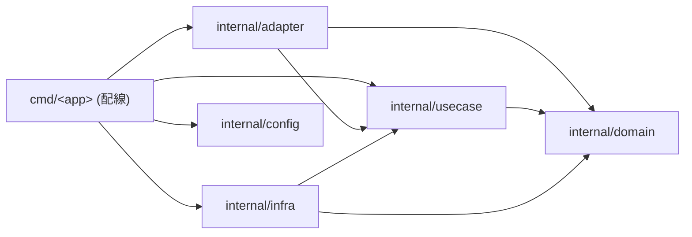

# Nuage バックエンド設計標準（Go）

本ドキュメントは、Nuage エコシステム（`nuage-monitoring-stack` の `monitoring-pwa/backend`、`pechka` の `api`・`batch/*`、`bare-web-proxy` 等）における Go バックエンドの標準アーキテクチャ、層と責務、依存の向き、および品質担保のためのガードレールを定義する。

---

## 1. 目的

- **書く場所で迷わない**: 新しい API、外部連携、ビジネスルール、バッチ処理を追加するときに、置くべき場所が一意に決まる状態を作る。
- **責務の明確な分離**: 入力の受付（HTTP 等）、アプリケーションの操作、ドメインの規則、外部への永続化・通知を明確に分ける。
- **リポジトリ横断の統一感**: どのリポジトリを開いても同じ構造・同じ命名で読めるようにし、保守や機能追加の学習コストを下げる。

---

## 2. アーキテクチャ構成（レイヤー型）

Nuage の Go バックエンドは、Clean Architecture をベースとした**レイヤー型アーキテクチャ**を採用する。

### 2.1. ディレクトリ構成と各層の責務

```text
cmd/<app>/main.go     設定を読み、各層を組み立て（配線）、起動・停止するだけ
internal/
  domain/             型とルール。他の internal パッケージを import しない。JSON タグを付けない
  usecase/            アプリの操作（1 操作 = 1 メソッド）。必要な外部は port（interface）として usecase 側で宣言する
  adapter/            外から呼ばれる入口。HTTP API・Webhook・外部互換 API・SSE・WebSocket・バッチの起動口。リクエスト/レスポンスの DTO（JSON タグ）はここに置く
  infra/              外を呼ぶ出口。DB・外部 API・メッセージ配信など。usecase の port を実装する
  config/             環境変数の読み込みと検証（必要な値が無ければ既定値で続けずエラーにする）
```

各層の責務の詳細は以下のとおりである。

- **`cmd/<app>/main.go`**
  - エントリポイント。`config` を読み込み、`infra`・`usecase`・`adapter` の具象型を生成して依存を注入（配線）し、サーバーやワーカーの起動・グレースフルシャットダウンを行う。
  - ルーティングの個別登録やビジネスロジック、定期実行の個別処理などを `main.go` に直接書かない。
- **`internal/domain/`**
  - システムの中核となるエンティティ、値オブジェクト、ドメインエラー、および業務上の判定・計算・値の規則を置く。
  - 永続化や通信形式（JSON・DB カラム・外部 API 仕様）に依存しない純粋な Go の型として定義する（`json:"..."` や `db:"..."` 等の構造体タグを付けない）。
- **`internal/usecase/`**
  - 「ユーザーが何をできるか」「システムが何をするか」というアプリケーション固有の操作を表現する（原則 **1 操作 = 1 メソッド**）。
  - 複数の副作用（例: DB への保存と、画面・Bot・Push への通知）を伴う手順のオーケストレーションもこの層が担う。
  - 外部リソース（DB、外部 API、通知配信など）が必要な場合は、**利用側である `usecase` 側で `port`（interface）を宣言**し、`usecase` の構造体がそれに依存する。
- **`internal/adapter/`**
  - 外部からの入力を受け取り、`usecase` を呼び出して結果を返す入口（HTTP ハンドラー、Webhook、外部互換 API、SSE / WebSocket、CLI / バッチの起動口など）。
  - サブパッケージでプロトコルや役割ごとに分ける（例: `adapter/http/`、`adapter/batch/`）。
  - リクエストおよびレスポンスの DTO（`json:"..."` タグ付きの構造体）はここに置き、`domain` の型と相互変換する。これにより、内部構造を変えても外向きの API 契約を維持できる。
  - ルーティング定義は `adapter/http/router.go` に集約する。
- **`internal/infra/`**
  - `usecase` が定義した `port`（interface）を実装し、DB への読み書き、外部 HTTP API の呼び出し、メッセージ配信などの技術的詳細を担う。
  - 技術要素や接続先サービスごとにサブパッケージを切る（例: `infra/postgres/`、`infra/mongo/`、`infra/webpush/`）。
  - 外部サービスのレスポンス構造体や DB スキャン用の一時構造体など、技術固有の型はこの層に閉じ込める。
- **`internal/config/`**
  - 環境変数や設定ファイルの読み込みとバリデーションを行う。
  - 必須の設定値が欠落している場合や不正な場合は、暗黙の既定値で続行せず明示的にエラーを返して起動を止める。

---

## 3. 依存の向きと機械検証（ガードレール）

### 3.1. 依存関係のルール



各層間の依存は、以下の規則を厳守する。

1. **許可される依存の向き**: `adapter` → `usecase` → `domain`、および `infra` → `usecase`（`port` 参照）/ `domain`。
2. **`domain` の独立**: `domain` は同じモジュールの他の `internal` パッケージを一切 import しない。
3. **`usecase` の純粋性**: `usecase` は `adapter`、`infra`、Web フレームワーク、DB ドライバを import しない。
4. **`adapter` と `infra` の分離**: `adapter` は `infra` を import せず、`infra` も `adapter` を import しない。
5. **配線の局所化**: 具象型の組み立て（DI）は `cmd/<app>/` だけで行う。

### 3.2. `go test ./...` による自動検査

依存関係のルールはレビュー時の目視に頼らず、**各 Go モジュール内の `internal/arch_test.go` に依存方向を検査するテストを置き、`go test ./...` の実行で違反を落とす**仕組みとする。

- 新しい静的解析ツールや `go.mod` への外部依存は追加せず、Go 標準ライブラリ（`go/parser`・`go/token`、または `go list -json` の実行）のみを用いたテストとして実装する。
- `usecase` 層の純粋性（Web フレームワークや DB ドライバ等の import 禁止）はモジュールごとに検査の強さがばらつかないよう**許可リスト方式**で判定し、原則として Go 標準ライブラリと同一モジュールの `internal/domain` のみを import 可能とする。
- これにより、ローカル開発時および CI 上の通常のテスト実行だけでアーキテクチャ境界の違反を即座に検知できる。

---

## 4. 書く場所の早見表

新規実装や修正を行う際は、以下の表に従って配置先を決める。

| 新しく書くもの | 書く場所 |
|---|---|
| API を 1 本足す | `adapter/http/<機能>.go`（ハンドラーと DTO）と `usecase/<機能>.go`（操作） |
| 定期実行・バッチ・ワーカー | `adapter/batch/<機能>.go`（起動口）と `usecase/<機能>.go`（処理） |
| DB の読み書き | `usecase/port.go` に interface、`infra/<DB名>/<機能>.go` に実装 |
| 外部サービスを呼ぶ | `infra/<サービス名>/` に実装、port（interface）は `usecase/port.go` に置く |
| 判定・ルール・値の規則 | `domain/` |
| ルーティング | `adapter/http/router.go` |
| 環境変数・起動設定の追加 | `config/` |
| 依存の組み立て・起動処理 | `cmd/<app>/main.go` |

### テストの置き方

- **単体テスト**: 各層（`domain`、`usecase`、`adapter`、`infra`）と同じディレクトリに `*_test.go` を置く。`usecase` のテストでは `port` のフェイク／モックを差し替えてロジックを検証する。
- **契約テスト（スナップショット）**: 外部から見える HTTP API 等の振る舞いは、`adapter/http/` 配下などにゴールデンファイルを用いた契約テストとして配置し、内部リファクタリングによる意図しない仕様変更を防ぐ。

---

## 5. 判断の経緯（背景）

本標準を策定するにあたり、検討した選択肢および既存コードベースで観測された課題を記録する。

### 5.1. レイヤー型を採用した理由

構成案として、**レイヤー型**（`domain` / `usecase` / `adapter` / `infra` で切る）と、**機能型**（`chat/`・`alert/` のように機能ごとにフォルダを切り、その中に handler・service・store を置く）を比較検討した。

- **レイヤー型を選んだ理由**: どの機能であっても「どこに何を書くか」が同じになり迷わないため。機能型は、複数の機能をまたぐ処理や共通のドメインルールが出てきた際に置き場所で迷いやすい。
- **トレードオフ**: 小さな機能を追加する場合でも、ファイルが `adapter`・`usecase`・`infra` の 2〜3 箇所に分かれる。これは責務分離と統一感を優先した結果として受け入れる。

### 5.2. 標準策定のきっかけとなった共通課題

`monitoring-pwa/backend` および `pechka/api` の既存実装を調査する中で、以下の共通課題が観測された。

1. **操作層の欠如とロジックの散在**: `usecase` に相当する層がなく、HTTP ハンドラーが DB 層を直接呼び出している。結果としてビジネスルールがハンドラー・DB 層・`main` に散らばっている。
2. **ドメイン型の保存先・通信形式への結合**: ドメインモデルが外部表現に縛られている（例: `monitoring-pwa` の `push.Message` における JSON タグ付与、`pechka` の `domain.MongoContent`）。
3. **interface 宣言の重複**: 依存先の interface を利用側（各ハンドラー等）がその場で個別宣言しているため、同じような interface が複数箇所に重複している（例: `monitoring-pwa` の `PushSender` 二重定義、`pechka` のハンドラーごとの `pgContentRepository` 等）。
4. **`main.go` の肥大化**: ルーティングや配線のコード以外に、処理本体や補助ロジックが `main.go` に溜まっている（例: `pechka` の 392 行に及ぶ `main.go` や `minioPlaylistRefresher`）。
5. **副作用の重複**: 「保存した後に画面・Bot・Push へ通知する」といった一連の副作用が、複数箇所に重複して書かれている（`monitoring-pwa`）。

---

## 6. 既存リポジトリの移行方針と適用状況

### 6.1. 載せ替えの進め方

既存の Go バックエンドを本標準へ移行する際は、フロントエンドや外部利用者に影響を与えないため、以下の手順で進める。

1. **契約テストの先行追加**: 構造を変える前に、外から見える HTTP レスポンス等の出力を検証する契約テスト（スナップショット／ゴールデンテスト）を追加し、単体のコミットとして分ける。
2. **層の分離と載せ替え**: 新しい層構造へコードを移し替える。この際、API の入出力形式は `adapter` 層の DTO によって従来の形を保つ。
3. **契約維持の検証**: 載せ替え後も、手順 1 で追加した契約テストのゴールデンファイルを変更せずにそのまま通ることを確認する。

### 6.2. 適用状況

| リポジトリ / コンポーネント | 適用状況 | 備考 |
|---|---|---|
| `nuage-monitoring-stack` (`monitoring-pwa/backend`) | 載せ替え中 | 先行して契約テストを追加し、新構成へ移行中 |
| `pechka` (`api`) | 未適用（次の予定） | `monitoring-pwa/backend` に続いて移行予定 |
| `pechka` (`batch/*`) | 未適用 | — |
| `bare-web-proxy` | 未適用 | — |
