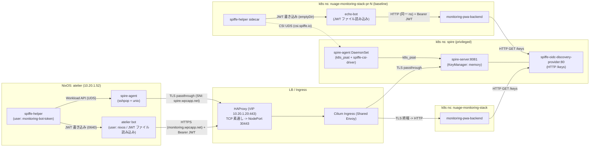

# サーバー間認証標準・SPIRE 導入設計

本ドキュメントは、Nuage エコシステムにおけるサーバー間（サービス間）認証・暗号化の標準方針（第 1 部）と、SPIRE（SPIFFE）を用いた初回導入の具体設計およびリポジトリ間の取り決め（第 2 部）を定義する。

---

## 第 1 部: サーバー間認証の標準

今後 Nuage 上で新規作成・改修するすべてのサービスは、本標準に従ってサーバー間認証を設計・実装する。

### 1. 基本原則

1. **暗号化は基盤が担う**:
   - ネットワーク境界および Ingress では TLS を用いる（現状は Cilium Ingress での TLS 終端・Let's Encrypt）。
   - 将来的な Pod 間・ノード間の通信路暗号化は、基盤側（Cilium の WireGuard / ztunnel 等）で担う。アプリケーションは通信相手の TLS 証明書配布や鍵管理を個別に抱えない。
2. **認証はアプリ層で SPIFFE JWT-SVID を使う**:
   - HTTP / WebSocket ベースのサーバー間通信の認証には、SPIRE が発行する短寿命な **JWT-SVID**（`Authorization: Bearer <JWT-SVID>`）を用いる。
   - サービスの再構築やスケール時にも事前の鍵発行・シークレット配布を不要にし、ステートレスな運用を保つ。
3. **JWT を扱えない経路の方針（X.509-SVID mTLS）**:
   - PostgreSQL・etcd 等の JWT-SVID を扱えないミドルウェア通信、および基盤の通信路暗号化が届かない NixOS ↔ NixOS 間の経路（例: `lm-server` ↔ Victoria 等）には、**X.509-SVID による mTLS** を用いる方針とする。
   - ただし X.509-SVID mTLS の具体実装は本フェーズの対象外であり、今後の導入時に別設計として具体化する。
4. **静的共有トークンの禁止**:
   - サービス間認証のための静的な共有シークレット（API キー、固定の `xoxb-` / `xapp-` トークン、共有パスワード等）を新規に作成しない。既存の静的トークンも順次 JWT-SVID へ移行する。

### 2. SPIFFE ID の名付け規則

Trust Domain は **`nuage`** に統一する。

| 対象種別 | SPIFFE ID 形式 | 例 |
| :--- | :--- | :--- |
| Kubernetes Pod | `spiffe://nuage/ns/<ns>/sa/<sa>` | `spiffe://nuage/ns/nuage-monitoring-stack-pr-42/sa/echo-bot` |
| NixOS サービス | `spiffe://nuage/host/<host>/<service>` | `spiffe://nuage/host/atelier/bot` |

- **専用 ServiceAccount の原則**: Kubernetes Pod に身元を付与する場合、`default` ServiceAccount を流用せず、用途ごとに専用の ServiceAccount を作成して割り当てる。
- **`<host>` と `<service>`**: `<host>` は `nuage-cluster` の `.ssh/ssh_config` および `nix/flake.nix` で用いるホスト名と一致させる。`<service>` はサービス役割を表す小文字ケバブケースとする。

### 3. 受け側の検証ルール

受け側サービスは、受信した JWT-SVID に対して以下をすべて検証する。1 つでも欠ける場合は `401 Unauthorized`（または互換エラー）として即座に拒否し、既定値やフォールバックで通さない。

1. **署名検証（JWKS）**:
   - SPIRE OIDC Discovery Provider が配信する JWKS から公開鍵を取得・キャッシュして署名を検証する。
   - 受信した JWT ヘッダの `kid` がキャッシュに存在しない場合は、最短再取得間隔（クールダウン、例: 5 秒）を設けたうえで JWKS を再フェッチし、SPIRE Server 再起動に伴う鍵更新へ自動追従する。
2. **有効期限検証（`exp` / `nbf`）**:
   - `exp` が過ぎていないこと、`nbf` が未来すぎないことを検証する（クロックスキュー許容は 30 秒以内とする）。
3. **対象者検証（`aud`）**:
   - `aud` クレームに「受け側自身のサービス識別子」が含まれることを検証する。他サービス向けのトークン流用を許さない。
   - **受け側の `aud` は環境（デプロイ先）ごとに一意にする**（例: 本番 `monitoring-pwa`、preview `monitoring-pwa.nuage-monitoring-stack-pr-42`）。信頼度の低い環境（preview 等）と本番で同じ `aud` を使わない（preview 側コードが受け取った JWT-SVID を本番へ流用するのを防ぐため）。
4. **呼び出し元認可（`sub` 許可リスト）**:
   - `sub` クレーム（呼び出し元の SPIFFE ID）が、**git で宣言された許可リスト**（必要に応じてロールやアプリ内ユーザー ID との対応表を含む）に完全一致することを検証する。
   - 許可リストが未設定または空の状態で起動した場合はエラーとして起動を止める。

#### Go バックエンドでの実装層（`docs/backend-architecture.md` 準拠）

Go バックエンドで JWT-SVID 検証を実装する場合は、`github.com/spiffe/go-spiffe/v2` または標準的な JWT/OIDC ライブラリ（例: `github.com/golang-jwt/jwt/v5` + JWKS 取得クライアント）を使用し、[docs/backend-architecture.md](backend-architecture.md) の層分けに従って以下に配置する。

| 層 | 配置する責務 |
| :--- | :--- |
| `internal/config/` | JWKS URL、期待する `aud`、許可 `sub` リスト（対応表）の読み込みと必須チェック。欠落時は起動エラーにする。 |
| `internal/domain/` | 認証済みの呼び出し元を表す純粋な Go 型（例: `BotIdentity`、JSON タグなし）。 |
| `internal/usecase/` | 検証ポート（例: `BotTokenVerifier` interface）の宣言と、`sub` に基づく認可・ドメイン識別子の解決。JWT ライブラリや HTTP に依存しない。 |
| `internal/infra/` | JWKS の HTTP 取得・キャッシュと JWT 署名・`exp`・`aud` 検証の具象実装（例: `infra/spiffe/`）。 |
| `internal/adapter/` | リクエストの `Authorization: Bearer <token>` からトークン文字列を取り出し、`usecase` へ渡すだけにする。`infra` を import しない。 |
| `cmd/<app>/main.go` | `config` で読み込んだ設定をもとに `infra` の検証器を生成し、`usecase` へ注入する。 |

### 4. 送り側の約束

1. **既定はアプリが JWT-SVID ファイルを毎回読む（トークンファイル方式）**:
   - 送り側アプリケーションは、SPIFFE 公式の **`spiffe-helper`**（`github.com/spiffe/spiffe-helper`）が SPIRE Agent の Workload API から取得・自動更新してファイルへ書き出した **JWT-SVID ファイル**を、API 呼び出し・接続のたびに毎回読み込み、`Authorization: Bearer <JWT-SVID>` として宛先へ直接送信する。
   - **アプリが Workload API を直接使わない理由**:
     - Workload API のアクセス権は OS ユーザーや Pod 単位で付与されるため、アプリ実行ユーザーに Workload API ソケットを開放すると、そのユーザーの全プロセス（同一ユーザーで動く別エージェント等）が任意の `aud` の JWT-SVID を発行できてしまう。
     - 言語やフレームワークごとの SPIFFE ライブラリの有無・成熟度に左右されず、ファイルを毎回読むだけで全言語で統一的に扱える。
   - **例外（ローカルプロキシを許容する条件と注意点）**:
     - ソースコードを改修できない既製アプリケーション（既存バイナリや外部パッケージ等）に限って、ローカルループバック（`127.0.0.1:<port>`）で動くトークン付与プロキシを例外的に使ってよい。
     - ただしプロキシ方式を採る場合は、① `127.0.0.1` に接続できる同一ホスト内の他プロセスがプロキシの SPIFFE ID を使えてしまう点（必要に応じて OS ユーザー分離や `nftables` の `meta skuid` で制限する）、② Ingress 向けの `Host` ヘッダ書き換えが必要になる点、③ 宛先・`aud` ごとにプロキシインスタンスを分離する点に注意する。
2. **短寿命・宛先限定**:
   - JWT-SVID の有効期限（TTL）は数分（標準 **`5m`**）とし、アトミック置換に対応した `spiffe-helper`（**v0.12.x 以上**。0.11.x 以前は `os.WriteFile` による非アトミック上書きのため推奨しない）が `jwt_svids` 設定に基づいて期限前に自動でファイルを更新する。
   - あわせて送り側アプリでも、ファイル読み込み結果が空文字列や不正な形式（JWT の `.` 区切り 3 パートを満たさない等）であった場合は即座に送信せず、短時間待って再読み込みする防御を入れる。
   - `aud` は宛先サービス（環境を含む）ごとに一意に固定して別ファイルへ書き出す。異なる宛先や異なる環境（本番と preview 等）へ同じトークンファイルを使い回さない。
3. **既存 SDK との互換（キャッシュ・再接続対策）**:
   - `slack_bolt` や `slack_sdk` 等のクライアントライブラリは起動時に渡したトークンをインスタンス内に保持することがあるため、静的に 1 回だけ読み込まない。
   - API 呼び出し時は `authorize` フックやリクエスト直前の読み込みで毎回最新の JWT-SVID ファイルを読み直し、Socket Mode の再接続時も `apps.connections.open` へ渡す app トークンが古いままにならないよう再接続前にファイルを読み直す仕組みを入れる。

### 5. 新しいサービスに身元を付ける手順

SPIRE Server に対する手動の `spire-server entry create` は行わず、すべて git で宣言する。

1. **送り側の身元を宣言する（`nuage-cluster`）**:
   - **Kubernetes Pod の場合**: アプリ側マニフェストで専用 `ServiceAccount` を作成して Pod に割り当て、`nuage-cluster` の `manifests/apps/spire/` に `ClusterSPIFFEID` を宣言する。
   - **NixOS サービスの場合**: `spiffe-helper` 用の専用 OS ユーザー（および必要に応じて専用グループ）を定義し、`nuage-cluster` の `manifests/apps/spire/` に `ClusterStaticEntry`（親 ID にホストの `sshpop` エージェント、セレクタに `unix:user:<専用ユーザー>`）を宣言する。
2. **送り側に `spiffe-helper` を配置する**:
   - Kubernetes Pod はサイドカーコンテナ（共有 `emptyDir` に書き出し）、NixOS サービスは専用ユーザーの systemd ユニットとして `spiffe-helper` を起動し、対象宛先の `aud` と出力ファイルパスを設定する。
   - アプリ側には宛先 URL（`SLACK_API_BASE_URL` 等）と JWT-SVID ファイルのパス（`SLACK_BOT_TOKEN_FILE` / `SLACK_APP_TOKEN_FILE` 等）を設定する。
3. **受け側の許可リストへ登録する（対象アプリのリポジトリ）**:
   - 受け側サービスの許可リスト（ConfigMap / 環境変数定義）に送り側の SPIFFE ID（`sub`）を追記し、PR・Argo CD 経由で反映する。

---

## 第 2 部: 今回の導入設計とリポジトリ間の取り決め

初回適用対象である **「atelier（NixOS）の bot → 本番 `monitoring-pwa`」** および **「preview `echo-bot`（Pod）→ preview `monitoring-pwa`」** を構築するため、`nuage-cluster` と `nuage-monitoring-stack` が並行実装で食い違わない仕様と取り決めを以下に確定する。

### 1. 全体構成



### 2. SPIRE 基盤の設計（`nuage-cluster`）

#### 2.1. 配置と導入方式

- **Namespace**: `spire`
  - `spiffe/helm-charts-hardened` は既定で `spire-server` と `spire-system` に Namespace を分割するが、`global.spire.namespaces`（`server.name: "spire"`, `system.name: "spire"` 等）または各コンポーネントの `namespaceOverride` で単一 Namespace **`spire`** に統一する。
  - `spire-agent` と `spiffe-csi-driver` がホストパス・CSI ソケットの特権を要するため、Namespace ラベルに PSA `privileged`（`pod-security.kubernetes.io/enforce: privileged`）を付与する。
- **導入チャート**: `spiffe/helm-charts-hardened`（`spire-crds` および `spire` チャート）を `nuage-cluster/manifests/apps/spire/` に配置する。
  - 既存の `nuage-cluster/manifests/apps/appset-prod.yaml` は `manifests/apps/*/overlays/prod` を自動検知し、`argocd-vault-plugin-kustomize`（`kustomize build --enable-helm .`）でレンダリングしてディレクトリ名と同じ Namespace（`spire`）へ配備する。この規約に従い、`manifests/apps/spire/base/` と `manifests/apps/spire/overlays/prod/` を作成する。
  - `spire-crds` は `spire` 本体より先に CRD が存在する必要があるため、Argo CD SyncWave（例: `spire-crds` 側を別ディレクトリまたは SyncWave `-1`）または `includeCRDs: true` の適用順序に留意する。
  - Helm チャートの既定 Service 名はリリース名プレフィックスが付くため、`spiffe-oidc-discovery-provider.fullnameOverride: "spiffe-oidc-discovery-provider"` および `spire-server.fullnameOverride: "spire-server"` を指定して Service 名を固定する。

#### 2.2. SPIRE Server・ステートレス設定・JWKS

| 項目 | 決定値 | 備考 |
| :--- | :--- | :--- |
| Trust Domain | `nuage` | 全環境共通 |
| クラスタ名 (`clusterName`) | `nuage` | `k8s_psat` の親 SPIFFE ID に使用 |
| `KeyManager` | `memory` | CA 鍵を永続化せず RAM 上のみで保持（`disk` は無効化） |
| `DataStore` | `sql` (`sqlite3`) | `persistence.enabled: false`（`emptyDir` 上の使い捨て。PVC 不使用） |
| `spire-server` レプリカ / 更新戦略 | `replicaCount: 1`、`updateStrategy.type: Recreate` | メモリ鍵のため単一インスタンス＋再作成で鍵不整合を防ぐ |
| JWT-SVID デフォルト TTL | `5m` | 短寿命トークン原則に準拠 |
| Controller Manager | 有効 (`spire-controller-manager`) | `ClusterSPIFFEID` / `ClusterStaticEntry` を監視・登録 |
| Controller 既定 ID の無効化 | `identities.clusterSPIFFEIDs.default.enabled: false` | 全 Pod 自動配布によるエントリ重複・TTL 競合を防ぐ |
| Controller `className` | `"nuage"`（`watchClassless: false`） | 管理対象 CR を明示し、意図しない無指定 CR や他系との衝突を防ぐ |
| `sshpop` NodeAttestor | `unsupportedBuiltInPlugins.nodeAttestor.sshpop` | 下表の設定と CA 公開鍵 ConfigMap マウントで有効化 |
| OIDC Discovery Provider Service 名 | `spiffe-oidc-discovery-provider` | Namespace `spire`（`fullnameOverride` で固定）、ClusterIP port `80` |
| OIDC Discovery Provider スキーム設定 | `allow_insecure_scheme: true` | クラスタ内通信のため HTTP で提供（外部 Ingress 公開しない） |
| **JWKS URL（確定値）** | `http://spiffe-oidc-discovery-provider.spire.svc.cluster.local/keys` | `monitoring-pwa` に渡す URL |

- **OIDC Discovery Provider の `domains`**: `spiffe-oidc-discovery-provider.spire.svc.cluster.local` と `spiffe-oidc-discovery-provider.spire.svc` を指定する。
- **`spire-server` 側の `sshpop` 設定**: `helm-charts-hardened` には `sshpop` の専用トグルが無いため、`spire-server.unsupportedBuiltInPlugins.nodeAttestor.sshpop` にプラグイン設定を記述し、`manifests/apps/spire/base/ssh-ca.pub` から生成した ConfigMap を `extraVolumes` / `extraVolumeMounts` で `/etc/spire/ssh/ssh-ca.pub` へマウントする。ホスト証明書の署名更新や確認コマンドぶれを防ぐため、`agent_path_template` でホストの principal 名ベースの固定 SPIFFE ID を割り当てる。SPIRE の `sshpop` はテンプレート出力の前に `/spire/agent` を自動付与するため（既定は `/{{ .PluginName }}/{{ .Fingerprint }}`）、テンプレート側には `/spire/agent` を含めない。`canonical_domain` を付けずにホスト証明書の先頭 principal（`-n "<host>"`）を `.Hostname` として使い、`spiffe://nuage/spire/agent/sshpop/<host>` を生成させる。
  ```yaml
  spire-server:
    unsupportedBuiltInPlugins:
      nodeAttestor:
        sshpop:
          plugin_data:
            cert_authorities_path: "/etc/spire/ssh/ssh-ca.pub"
            agent_path_template: "/{{ .PluginName }}/{{ .Hostname }}"
  ```
- **ステートレス再起動時の挙動**: SPIRE Server 再起動時は CA 鍵と SQLite が初期化され、新しい CA 鍵が生成される。`spire-controller-manager` が CRD から登録エントリを再同期し、OIDC Discovery Provider が新公開鍵を `/keys` に反映する。Agent がキャッシュ済みバンドルとの不一致で再接続に失敗しないよう、Agent 側のブートストラップ設定・再起動追従を「実装で最初に確かめること」で確認する。

#### 2.3. atelier からの接続経路（`spire.wpcapp.net` / TLS passthrough）

- **FQDN**: `spire.wpcapp.net`（接続ポート `443`）
- **DNS・LB**: 変更しない。
  - LB の CoreDNS（`nix/hosts/loadbalancer/dns.nix`）が `*.wpcapp.net` を SDN クライアント（atelier `10.20.1.52` を含む）向けに `10.20.1.20` へ解決する。
  - LB の HAProxy（`nix/hosts/loadbalancer/haproxy.cfg`）は `*:443` を `mode tcp` のまま worker の NodePort `30443` へ素通しする。
- **Cilium Ingress 設定**: `spire` Namespace に以下を配置し、SNI で TLS ストリームを復号せず `spire-server:8081` へ転送する。cert-manager の TLS Secret は作らない（SPIRE Server 自身が SPIFFE 証明書で終端するため）。
  - `ingressClassName: cilium`
  - `annotations`: `ingress.cilium.io/tls-passthrough: "enabled"`
  - `spec.rules[0].host`: `spire.wpcapp.net`
  - `backend.service`: `name: spire-server`, `port.number: 8081`（Helm チャートの実際の Service 名・ポート名に合わせる）
- **うまくいかない場合の代替案**:
  1. **代替案 1**: Cilium Gateway API の `Gateway` + `TLSRoute` を使う（Cilium values への `gatewayAPI` 有効化要否を確認する）。
  2. **代替案 2**: Ingress / Gateway API のいずれも `spire-agent` が接続できない場合は、実装を進めず人間に戻す（代替構成は SPIRE Server を NixOS LXC に置く案であり、LXC 追加と `terragrunt apply` が必要になるため）。

#### 2.4. k8s SPIRE Agent と `spiffe-csi-driver`

- `spire-agent` DaemonSet を有効化し、`nodeAttestor` は `k8s_psat` を使う。
- `spiffe-csi-driver` DaemonSet を有効化し、Pod が `csi.spiffe.io` インラインボリュームで Workload API ソケット（コンテナ内 `/spiffe-workload-api/spire-agent.sock`）をマウントできるようにする。

---

### 3. atelier の SPIRE Agent と SSH CA（`nuage-cluster`）

#### 3.1. NixOS モジュールと設定

- **モジュール**: `nuage-cluster/nix/modules/spire-agent.nix` を新設し、`nuage-cluster/nix/hosts/atelier/configuration.nix` から import する。
- **パッケージ**: nixpkgs の `pkgs.spire-agent`（`pkgs.spire` 系統）を使用する。
- **Server 接続先**: `server_address = "spire.wpcapp.net"`, `server_port = "443"`, `trust_domain = "nuage"`, `insecure_bootstrap = true`。
- **NodeAttestor (`sshpop`)**:
  - `host_key_path = "/var/lib/nix-provisioning/ssh_host_ed25519_key"`（既存の cloud-init 配置鍵。VM 再作成時も `host-keys.yaml` から復元される）。
  - `host_cert_path = "/etc/spire/atelier-cert.pub"`（git 管理下の `.ssh/certs/atelier-cert.pub` を NixOS 設定で配置）。
  - `/var/lib/nix-provisioning/ssh_host_ed25519_key` は `root:root` (`0600`) であるため、`spire-agent.service` は `root` または systemd `LoadCredential` 経由で鍵を読み込む（`systemd` workload attestor のため D-Bus・`/proc` 参照権限も確保する）。
- **WorkloadAttestor**:
  - `WorkloadAttestor "unix" {}` および `WorkloadAttestor "systemd" {}` を有効にする。
  - `spiffe-helper` サービス（`monitoring-bot-token.service` および必要時の preview 用インスタンス）は専用の非特権 OS ユーザー **`monitoring-bot-token`**（`spire-agent` グループ所属）で実行する。これによりどのインスタンスが Workload API ソケットへ接続しても `unix:user:monitoring-bot-token` セレクタが付与される。
  - 一方、bot 本体を動かす `nixos` ユーザー（`nuage-cluster/nix/hosts/atelier/configuration.nix` の `programs.autopilot5.user = "nixos"`）は `spire-agent` グループへ入れない。
- **Workload API ソケットパス**: `/run/spire/sockets/agent.sock`（`0660`、グループ `spire-agent` で保護し、`spiffe-helper` 以外の一般ユーザーから直接接続できないようにする）。
- **ステートレス Server 追従とブートストラップのリスク**:
  - `data_dir` を揮発性ディレクトリ（例: systemd の `RuntimeDirectory=spire-agent` による `/run/spire-agent`）に置き、`insecure_bootstrap = true` と組み合わせることで Server 再起動後の新 CA 鍵へ自動追従できる。
  - ただし、`insecure_bootstrap = true` と揮発 `data_dir` の組み合わせは、Agent が再起動するたびに Server 証明書を事前検証なしに信用し直す（TOFU の反復）ことになる。通信経路は SDN / LAN 内に閉じるが、経路上のなりすましリスクを低減したい場合は、代替案として Let's Encrypt 等の公開 TLS 証明書を持つ HTTPS エンドポイント（または k8s 側の SPIRE Bundle Endpoint）を `trust_bundle_url` に指定してバンドルを取得する方式を検討する。

#### 3.2. `ClusterStaticEntry`（atelier の bot）

`nuage-cluster/manifests/apps/spire/` に宣言する。Server 側の `agent_path_template` により `sshpop` エージェント ID がホスト principal で固定されるため、証明書を更新しても `parentID` は変わらない（`spire-server agent list` で実値の一致を確認する）。

```yaml
apiVersion: spire.spiffe.io/v1alpha1
kind: ClusterStaticEntry
metadata:
  name: atelier-monitoring-bot
spec:
  className: nuage
  spiffeID: "spiffe://nuage/host/atelier/bot"
  parentID: "spiffe://nuage/spire/agent/sshpop/atelier"
  selectors:
    - "unix:user:monitoring-bot-token"
  jwtSVIDTTL: "5m"
```

- セレクタを `unix:user:monitoring-bot-token`（AND 条件の単一セレクタ）に統一することで、`atelier` 上で本番用（`aud=monitoring-pwa`）と preview 開発用（`aud=monitoring-pwa.nuage-monitoring-stack-pr-<N>`）の JWT-SVID を書き出しても、k8s 側の `ClusterStaticEntry` を PR ごとに増やすことなく双方へ `spiffe://nuage/host/atelier/bot` の SVID を発行できる。

#### 3.3. SSH CA とホスト証明書署名手順（人間の作業）

AI エージェントは SOPS 操作禁止ルールに従い、CA 秘密鍵の生成・SOPS 格納・ホスト証明書署名は人間が実行する。

- **SOPS ファイル配置**: `terraform/pve/hosts-secrets/ssh-ca.yaml`（新規）
  - `.sops.yaml` に `admin_key` と `master_key` のみを復号者とする `creation_rules` を追加する（Argo CD や個別ホストには復号させない）。
- **公開鍵の git 配置**:
  - `.ssh/ssh-ca.pub` と `manifests/apps/spire/base/ssh-ca.pub` に CA 公開鍵を置く（同一内容）。
  - 署名済みホスト証明書は `.ssh/certs/<host>-cert.pub`（今回は `.ssh/certs/atelier-cert.pub`）に保存し、公開情報として git にコミットする。
- **スクリプト対応（`nuage-cluster`）**:
  - `scripts/gen-host-keys.sh` を拡張する（または同ディレクトリに `scripts/sign-host-keys.sh` を追加し、`gen-host-keys.sh` からも呼び出せるようにする）。
  - 既存のホスト鍵を作り直さず、`.ssh/known_hosts`（または SOPS の `host-keys.yaml` から抽出した公開鍵）に対して `ssh-keygen -s` でホスト証明書だけを発行する `--sign-only <ホスト名>...`（例: `-h -I "<host>" -n "<host>" -V "+520w"` 等、長期運用またはローテーション前提）を用意し、`atelier` は既存のホスト鍵を保持したまま署名する。

---

### 4. JWT-SVID ファイル配信の設計（`spiffe-helper`）

#### 4.1. 採用理由（なぜ `spiffe-helper` による JWT ファイル方式を採るか）

- **自作トークン付与プロキシ（`spiffe-token-proxy`）を採らない理由**:
  - HTTP/WebSocket リバースプロキシを自作すると、プロキシの実装・単体テスト・コンテナイメージビルド・Nix パッケージ化および継続メンテナンスを自前で抱えることになる。
  - 送り側が API 呼び出しのたびに JWT-SVID ファイルを読み込んで `Authorization: Bearer` ヘッダを付ける実装は数行で済み、プロキシ・`Host` ヘッダ書き換え・ポート管理をまるごと不要にできる。
- **アプリが Workload API を直接使わない理由**:
  - SPIRE Agent の Workload API アクセス権は OS ユーザーや Pod 単位で付与される。bot 実行ユーザーへ Workload API ソケットを直接開放すると、同一ユーザーで動く他プロセス（atelier 上の別エージェント等）まで任意の `aud` の JWT-SVID を取得できてしまう。
  - ファイルを毎回読み込む方式であれば、言語・SDK 固有の SPIFFE ライブラリに依存しない。
- **`spiffe-helper` の採用利点**:
  - SPIFFE 公式ユーティリティである **`spiffe-helper`**（`github.com/spiffe/spiffe-helper`）が、`jwt_svids` 設定（`jwt_audience` と `jwt_svid_file_name`）に従って `aud` ごとに JWT-SVID を取得し、期限前にファイルを自動更新する。
  - Kubernetes サイドカー向けには組み込みの `health_checks` HTTP エンドポイント（`/live`・`/ready`）を持ち、`nuage-workspace` の `probes.rego` ポリシー要件も単体で満たせる。
  - **バージョンは v0.12.4 以上に固定して利用する**: `spiffe-helper` v0.11.0 以前は `os.WriteFile` による上書きであり更新瞬間にファイルが空・不完全になるおそれがある。一時ファイルへの書き込みと `rename` によるアトミック置換が行われる **v0.12 系（例: `0.12.4`）** を k8s サイドカー・atelier 双方で統一使用する。

#### 4.2. 置き場所と配置方針

新規リポジトリの作成および `nuage-cluster/tools/spiffe-token-proxy/`（コンテナイメージ・Nix パッケージ・`nix/modules/spiffe-token-proxy.nix`）は**作成しない**。

| 対象環境 | 成果物・利用パッケージ | 配置・権限・役割 |
| :--- | :--- | :--- |
| atelier（NixOS） | `spiffe-helper` **v0.12.4 以上**（nixpkgs の `pkgs.spiffe-helper` が `0.11.0` 等の 0.12 未満であれば、`buildGoModule` やバージョン上書きで `0.12.4` へ固定する）と NixOS モジュール（例: `nuage-cluster/nix/modules/spiffe-jwt-helper.nix`） | 専用の非特権 OS ユーザー `monitoring-bot-token` で systemd サービス（`monitoring-bot-token.service` 等）を実行する。JWT ファイルは `0640` で書き出し、bot 実行ユーザー（`nuage-cluster/nix/hosts/atelier/configuration.nix` の `programs.autopilot5.user = "nixos"`）だけが読めるグループ権限で保護する。 |
| preview `echo-bot`（k8s Pod） | 公式コンテナイメージ `ghcr.io/spiffe/spiffe-helper:0.12.4`（タグ固定） | `echo-bot` Pod のサイドカーコンテナとして動かし、共有の `emptyDir`（`medium: Memory`）へ JWT ファイルを書き出す。`echo-bot` コンテナはその共有ボリュームを `readOnly: true` でマウントして読む。 |

#### 4.3. `spiffe-helper` の設定項目と両環境での値

`spiffe-helper` は HCL 設定ファイル（`-config <path>`）で動作する。X.509-SVID 関連項目（`svid_file_name` 等）を省略し `jwt_svids` のみを指定することで、JWT-SVID の取得・更新のみを行う。

| 設定項目（HCL） | 説明 | atelier（本番用） | atelier（preview 用・任意） | preview `echo-bot` |
| :--- | :--- | :--- | :--- | :--- |
| `daemon_mode` | 常駐して期限前に自動更新 | `true` | `true` | `true` |
| `agent_address` | Workload API の UDS パス | `"/run/spire/sockets/agent.sock"` | `"/run/spire/sockets/agent.sock"` | `"/spiffe-workload-api/spire-agent.sock"` |
| `cert_dir` | JWT ファイル出力ディレクトリ | `"/run/monitoring-bot-token"` | `"/run/monitoring-bot-token"` | `"/run/spiffe/jwt"` |
| `jwt_svids[].jwt_audience` | 要求する `aud` クレーム | `"monitoring-pwa"` | `"monitoring-pwa.nuage-monitoring-stack-pr-<N>"` | `"monitoring-pwa.<POD_NAMESPACE>"` |
| `jwt_svids[].jwt_svid_file_name` | 出力ファイル名 | `"monitoring-pwa.jwt"` | `"monitoring-pwa-preview.jwt"` | `"monitoring-pwa.jwt"` |
| `jwt_svid_file_mode` | 出力ファイルのパーミッション | `0640` | `0640` | `0640`（同一 Pod 内共有） |
| `health_checks.listener_enabled` | HTTP ヘルスチェック有効化 | `false`（systemd で管理） | `false`（systemd で管理） | `true` |
| `health_checks.bind_port` / `liveness_path` / `readiness_path` | プローブ待ち受け設定 | — | — | `8081` / `"/live"` / `"/ready"` |

- **atelier での運用ルール（本番常時 + preview オプション）**:
  - 本番用 `aud`（`monitoring-pwa`）のファイル（`/run/monitoring-bot-token/monitoring-pwa.jwt`）は**常に生成**する。
  - preview 検証用のファイル（`/run/monitoring-bot-token/monitoring-pwa-preview.jwt`、`aud=monitoring-pwa.nuage-monitoring-stack-pr-<N>`）は、`nuage-cluster/nix/hosts/atelier/configuration.nix` のオプション（例: `previewPrNumber = <N>;`）を設定したときだけ追加で書き出す（本番用設定とは別ブロックまたは別ユニットとして扱い、本番用ファイルを上書きしない）。
  - 出力先 `/run/monitoring-bot-token`（`0750`）および JWT ファイル（`0640`）の所有者は `monitoring-bot-token`、グループは `nixos` のみが所属する専用グループ（または同等の限定グループ）とし、`nixos` ユーザー以外のローカルユーザーから読み取れないようにする。
- **preview `echo-bot` での namespace 反映とヘルスチェック**:
  - `aud` は Pod の Namespace から決まる（`monitoring-pwa.$(POD_NAMESPACE)`）。`spiffe-helper` 自身は HCL 内の環境変数展開を持たないため、init コンテナ（Downward API で `POD_NAMESPACE` を受け取る）で `helper.conf` を生成して設定用 `emptyDir` に置くなど、Namespace が自動反映される構成を採る。
  - `nuage-workspace` の `probes.rego` が全コンテナに `readinessProbe` / `livenessProbe` を要求するため、サイドカーでは `spiffe-helper` 組み込みの `health_checks`（`/ready` は全 `jwt_svids` ファイルの初回書き込み完了後に `200 OK`、`/live` は書き込み失敗が無ければ `200 OK`）を使用する。何らかの制約で `health_checks` を使えない場合のみ、ファイルの更新時刻等を検査する `exec` probe（distroless イメージにはシェルが無いため実行バイナリ構成に留意）に切り替える。

#### 4.4. 送り側アプリの設定項目と信頼の境界

atelier の bot と preview の `echo-bot` は、送り側の接続設定を以下の共通環境変数に統一する。プロキシは無いため `Host` ヘッダの書き換えも不要である。

| 環境変数名 | 説明 | atelier（本番 / preview） | preview `echo-bot` |
| :--- | :--- | :--- | :--- |
| `SLACK_API_BASE_URL` | 宛先の Slack 互換 API ベース URL | 本番: `https://monitoring.wpcapp.net/slack/api/`<br/>preview: `https://monitoring-pr-<N>.wpcapp.net/slack/api/` | `http://monitoring-pwa-backend/slack/api/` |
| `SLACK_BOT_TOKEN_FILE` | bot API 呼び出し時に毎回読む JWT ファイル | 本番: `/run/monitoring-bot-token/monitoring-pwa.jwt`<br/>preview: `/run/monitoring-bot-token/monitoring-pwa-preview.jwt` | `/run/spiffe/jwt/monitoring-pwa.jwt` |
| `SLACK_APP_TOKEN_FILE` | `apps.connections.open` 時に毎回読む JWT ファイル（bot 用と同ファイル可） | 同上 | `/run/spiffe/jwt/monitoring-pwa.jwt` |

- `SLACK_BOT_TOKEN_FILE` / `SLACK_APP_TOKEN_FILE` が設定されている場合、アプリは API 呼び出し・接続のたびにファイルを読み、`SLACK_BOT_TOKEN` / `SLACK_APP_TOKEN` より優先して `Authorization: Bearer <JWT-SVID>` を付与して宛先を直接呼ぶ。
  - **読み取り競合の防御**: 万一ファイル更新の瞬間に空値または JWT 形式不正（`.` 区切り 3 パートを満たさない等）を読み取った場合は、即座にリクエストを送らず短時間（例: 数十ミリ秒、最大数回）待って読み直す。
- **atelier における信頼の境界**:
  - SPIRE の `unix` workload attestor（`unix:user:monitoring-bot-token`）は `spiffe-helper` プロセスの実行ユーザーを証明し、通常権限の他プロセスから Workload API ソケットへの直接接続を遮断する。
  - 書き出された JWT ファイルを読めるのは、bot を動かす `nixos` ユーザーのプロセスである。atelier の bot はエージェント CLI のログインを使うため他のエージェントと同じ `nixos` ユーザーで動く見込みであり、通常権限でのファイルアクセス境界は **「`nixos` ユーザーのプロセス」** となる。これは旧プロキシ方式の「`127.0.0.1` に接続できるローカルプロセス全般」より狭い。
  - ただし現状の `atelier` では `nixos` ユーザーが `wheel` グループに所属しパスワードなし `sudo`（`security.sudo.wheelNeedsPassword = false`）が有効であるため、特権昇格を含めた実質的な信頼境界は `atelier` の `root` 相当となる（ユーザー分離の効果は通常稼働時の誤操作・直接利用を防ぐ範囲にとどまる）。

#### 4.5. Socket Mode の WebSocket 接続方式（確定仕様）

`nuage-monitoring-stack` の `monitoring-pwa/backend/internal/adapter/slackapi/dispatch.go`（`handleAppsConnectionsOpen`）は、受け取ったリクエストの `Host` と TLS / `X-Forwarded-Proto` から WebSocket URL（`wss://<Host>/slack/socket?ticket=<ticket>` または `ws://<Host>/slack/socket?ticket=<ticket>`）を組み立てて返す。

1. bot は `SLACK_APP_TOKEN_FILE` を読み、`Authorization: Bearer <JWT-SVID>` を付けて宛先（`<SLACK_API_BASE_URL>apps.connections.open`）を**直接**呼ぶ。
2. `monitoring-pwa` が JWT-SVID を検証し、検証された bot を記録したワンタイム `ticket` を発行して以下を返す。
   - **atelier → 本番**: `wss://monitoring.wpcapp.net/slack/socket?ticket=<ticket>`（Cilium Ingress 経由の HTTPS であり `X-Forwarded-Proto: https` が付くため `wss://` になる）
   - **preview `echo-bot` → preview backend**: `ws://monitoring-pwa-backend/slack/socket?ticket=<ticket>`
3. bot の `SocketModeHandler` は返却された WebSocket URL（ticket 付き）へそのまま接続する。`/slack/socket` はワンタイム `ticket` で認可されるため JWT は不要である。
4. **`slack_bolt` / `slack_sdk` でのトークン鮮度維持**:
   - **bot トークン**: `slack_bolt` の `authorize` フック（および起動時の `auth.test` 等の事前呼び出し）で、呼び出しのたびに `SLACK_BOT_TOKEN_FILE` から最新 JWT を読み直して渡す。
   - **app トークン**: `SocketModeHandler` 等の SDK 実装は初期化した `app_token` をインスタンスに保持し続けるため、長時間運用後の WebSocket 再接続時に期限切れの JWT を送らないよう、再接続前に `SLACK_APP_TOKEN_FILE` を読み直させる仕組み（接続クライアントのラッパーまたは再接続フック）を組み込む。

#### 4.6. atelier 開発中の bot との約束

`nuage-autopilot5` 側で開発中の atelier bot には、以下を接続仕様として伝える（`monitoring-pwa` のルーター実体 `router.go` は `/slack/api/:method` で待ち受けているため、ベース URL は末尾の `/slack/api/` まで含める）。

- **環境変数**:
  - `SLACK_API_BASE_URL`: 本番接続時は `https://monitoring.wpcapp.net/slack/api/`。
  - `SLACK_BOT_TOKEN_FILE` / `SLACK_APP_TOKEN_FILE`: `/run/monitoring-bot-token/monitoring-pwa.jwt`（同じファイルでよい）。設定時は API 呼び出し・接続のたびに読み込み、`SLACK_BOT_TOKEN` / `SLACK_APP_TOKEN` より優先する。
- **開発中の接続先と移行**:
  - Step 2 が `nuage-monitoring-stack` にマージされる前は、従来どおり preview の静的トークン（`https://monitoring-pr-<N>.wpcapp.net/slack/api/`）で進める。
  - Step 1-C および Step 2 マージ後の通常開発は、本番 URL（`https://monitoring.wpcapp.net/slack/api/`）と本番 JWT ファイル（`/run/monitoring-bot-token/monitoring-pwa.jwt`）へ接続する（開いている PR が無い期間もそのまま開発できる）。
  - 特定の開いている PR preview 環境へ繋いで検証したい場合のみ、`nuage-cluster/nix/hosts/atelier/configuration.nix` のオプション（例: `previewPrNumber = <N>;`）を設定して `nixos-upgrade` で preview 用 JWT ファイル（`/run/monitoring-bot-token/monitoring-pwa-preview.jwt`、`aud=monitoring-pwa.nuage-monitoring-stack-pr-<N>`）を出力させ、bot 側の `SLACK_API_BASE_URL` を `https://monitoring-pr-<N>.wpcapp.net/slack/api/`、`SLACK_*_TOKEN_FILE` を `/run/monitoring-bot-token/monitoring-pwa-preview.jwt` に向ける（`ClusterStaticEntry` は `unix:user:monitoring-bot-token` のまま変更不要）。

---

### 5. `monitoring-pwa` の改修仕様（`nuage-monitoring-stack`）

#### 5.1. 新しい環境変数と形式

`monitoring-pwa/backend/internal/config/config.go` から `SLACK_BOT_TOKEN` と `SLACK_APP_TOKEN` の読み込み・`xoxb-` / `xapp-` 必須検証を削除し、以下の環境変数へ置き換える。

| 環境変数名 | 必須 | 形式・内容 | 検証ルール |
| :--- | :--- | :--- | :--- |
| `SPIFFE_JWKS_URL` | 必須 | `http://spiffe-oidc-discovery-provider.spire.svc.cluster.local/keys` | 空不可。有効な `http://` または `https://` URL であること |
| `SPIFFE_JWT_AUDIENCE` | 必須 | 本番: `monitoring-pwa`、preview: `monitoring-pwa.$(POD_NAMESPACE)`（例: `monitoring-pwa.nuage-monitoring-stack-pr-42`） | 空不可（サービス名＋環境で一意な値を設定する） |
| `BOT_USERS_JSON` | 必須 | 許可する bot 一覧の JSON 配列（下例参照） | 1 件以上必須。`sub`（`spiffe://` 始まり・重複不可）、`user_id`（`U` 始まり・重複不可）、`bot_id`（`B` 始まり・重複不可）、`name`（空不可）。`is_default: true` は高々 1 件 |

`BOT_USERS_JSON` の JSON スキーマ例（複数 bot を区別する）:

```json
[
  {
    "sub": "spiffe://nuage/ns/nuage-monitoring-stack-pr-42/sa/echo-bot",
    "user_id": "U02ECHOBOT",
    "bot_id": "B02ECHOBOT",
    "name": "echo-bot",
    "is_default": true
  },
  {
    "sub": "spiffe://nuage/host/atelier/bot",
    "user_id": "U01BOT",
    "bot_id": "B01BOT",
    "name": "nuage-bot"
  }
]
```

#### 5.2. 本番・preview・base マニフェストの宣言方法

- **base（`nuage-monitoring-stack/k8s/base/monitoring-pwa/monitoring-pwa.yaml`）**:
  - `monitoring-pwa-backend` コンテナの `env` に残っている `SLACK_BOT_TOKEN` と `SLACK_APP_TOKEN` の `secretKeyRef`（`optional` 指定なし）を **必ず削除** する。Secret 側から項目を消したまま `secretKeyRef` が残ると `CreateContainerConfigError` で本番・preview とも起動不能になる。
  - 代わりに `SPIFFE_JWKS_URL` を base または各 overlay で設定する。`SPIFFE_JWT_AUDIENCE` は環境ごとに一意にするため base に共通既定値を置かず、各 overlay で必ず明示する。
  - `monitoring-pwa/backend/cmd/genauth` は、人間ログイン用の `COOKIE_SIGNING_KEY` と `USERS_JSON` 生成には引き続き必要なためツール自体は残し、`SLACK_BOT_TOKEN` と `SLACK_APP_TOKEN` の出力だけを削除する。
- **本番（`nuage-monitoring-stack/k8s/overlays/prod/`）**:
  - `k8s/overlays/prod/secrets/secrets.yaml` から平文の `SLACK_BOT_TOKEN` と `SLACK_APP_TOKEN` の 2 行を削除する（同ファイル内の `COOKIE_SIGNING_KEY`・`USERS_JSON`・`VAPID_*` は変更しない）。
  - 本番用設定（ConfigMap または `k8s/overlays/prod/` の Deployment パッチ。秘密情報ではないため SOPS 暗号化不要）で以下を宣言する。本番が受け付ける `sub` は **`atelier` の bot のみ** とする。
    - `SPIFFE_JWKS_URL`: `http://spiffe-oidc-discovery-provider.spire.svc.cluster.local/keys`
    - `SPIFFE_JWT_AUDIENCE`: `monitoring-pwa`
    - `BOT_USERS_JSON`: `[{"sub":"spiffe://nuage/host/atelier/bot","user_id":"U01BOT","bot_id":"B01BOT","name":"nuage-bot","is_default":true}]`
- **preview（`nuage-monitoring-stack/k8s/overlays/preview/`）**:
  - `k8s/overlays/preview/local-secrets.yaml` から `SLACK_BOT_TOKEN` と `SLACK_APP_TOKEN` の 2 行を削除する。
  - preview は **その namespace の `echo-bot` と `atelier` の bot の両方** を受け付ける。PR ごとに変わる preview Namespace 名に自動追従させるため、`k8s/overlays/preview/kustomization.yaml` の `monitoring-pwa-backend` パッチで **Kubernetes Downward API（`POD_NAMESPACE`）と環境変数展開 `$(POD_NAMESPACE)`** を使って宣言する（Argo CD の `ApplicationSet` テンプレートを変更する必要がない）。
    ```yaml
    - name: POD_NAMESPACE
      valueFrom:
        fieldRef:
          fieldPath: metadata.namespace
    - name: SPIFFE_JWKS_URL
      value: "http://spiffe-oidc-discovery-provider.spire.svc.cluster.local/keys"
    - name: SPIFFE_JWT_AUDIENCE
      value: "monitoring-pwa.$(POD_NAMESPACE)"
    - name: BOT_USERS_JSON
      value: '[{"sub":"spiffe://nuage/ns/$(POD_NAMESPACE)/sa/echo-bot","user_id":"U02ECHOBOT","bot_id":"B02ECHOBOT","name":"echo-bot","is_default":true},{"sub":"spiffe://nuage/host/atelier/bot","user_id":"U01BOT","bot_id":"B01BOT","name":"nuage-bot"}]'
    ```
  - preview 環境ではこの規則により、自 Namespace の `echo-bot` と `atelier` の bot のみが受け付けられ、他の PR（`pechka-pr-*` 等）からのなりすましを受け付けない。また `SPIFFE_JWT_AUDIENCE` が `monitoring-pwa.$(POD_NAMESPACE)`（`monitoring-pwa.nuage-monitoring-stack-pr-<N>`）でサービス名＋環境ごとに一意になるため、preview 向けに発行された JWT-SVID を本番（`aud=monitoring-pwa`）や同一 Namespace 内の他サービスへ流用できない。

#### 5.3. API・WebSocket 認可と bot 区別・配信設計

`monitoring-pwa` は `BOT_USERS_JSON` に宣言された bot ごとに独立した識別子（`user_id`・`bot_id`・`name`）を持ち、以下のように認証・投稿・イベント配信・メンション解決を行う。

1. **API 認証と呼び出し元 bot の特定（`POST /slack/api/:method`）**:
   - `Authorization: Bearer <token>`（新規方式では form の `token` パラメータでの送出は使わない）から JWT-SVID を検証し、`sub` に一致する `domain.BotIdentity`（`UserID`, `BotID`, `Name`）を解決する。
   - `auth.test` は呼び出した bot 自身の `user_id`・`bot_id`・`user`（`Name`）を返す。
   - `chat.postMessage` は呼び出した bot の `UserID`・`BotID`・`Username`（未指定時は `Name`）でメッセージを保存する。
   - `chat.update` は、対象メッセージの元の投稿者（`BotID` と `UserID`）が呼び出した bot と一致する場合のみ更新を許可する。一致しない場合（他 bot の投稿や人間の投稿に対する更新要求）は更新せず、Slack 本物と同じエラー（`cant_update_message`）を返す。
   - `users.info` は `BOT_USERS_JSON` に登録された全 bot（および `SystemBotUserID`）を対象にユーザー情報を返す。
2. **Socket Mode 接続の bot ごとの束ね（`apps.connections.open` / `/slack/socket`）**:
   - `apps.connections.open` は検証した JWT-SVID の `sub`（または対応する `BotIdentity`）をワンタイム `ticket` に紐づけて発行する。
   - `GET /slack/socket`（`SocketUsecase.AuthorizeSocket`）は静的 `appToken` による認可フォールバックを完全に削除し、**ワンタイム `ticket` のみ** で認可する。`ticket` 消費時に取り出した `BotIdentity` を `RegisterSocket` へ渡し、`socketConn` ごとに所属 bot（`BotIdentity` / `UserID`）を記録する。
3. **Socket Mode イベントの配信ルール（`infra/realtime/hub.go`）**:
   - **`message` イベント**: 接続中の **bot ごとに 1 本ずつ** 配信する（同じ bot が複数本の WebSocket を張っている場合のみ、その bot の接続群の中でラウンドロビンする。異なる bot 同士でイベントを取り合わない）。
   - **`app_mention` イベント**: メッセージ本文中の `<@U...>` メンションに一致する `UserID` を持つ接続中 bot にだけ配信する（複数 bot がメンションされていれば該当する各 bot へ 1 本ずつ配信する）。
   - **bot 自身の投稿の扱い**: Slack 本物と同様に、`chat.postMessage` による bot 投稿も `bot_id` と投稿 bot の `user` を付与した `message` イベントとして各 bot 接続へ配信する（`echo-bot` 等は `event.get("bot_id")` の存在で自己・他 bot 投稿を無視しループしない）。ただし無限ループ防止のため、`app_mention` イベントの生成は人間からの投稿（`msg.BotID == ""`）に限る。
4. **メンション検出・エイリアス置換と既存 `U01BOT` / `B01BOT` の移行方針（`domain/message.go` / UI）**:
   - `domain.NormalizeBotMentions` は `BOT_USERS_JSON` に登録された全 bot の `@<name>`（例: `@nuage-bot`、`@echo-bot`）をそれぞれの `<@<user_id>>` へ置換する。省略形の `@bot` は `is_default: true`（未指定なら先頭要素）の代表 bot（本番は `nuage-bot` / `U01BOT`、preview は `echo-bot` / `U02ECHOBOT`）の `<@<user_id>>` へ置換する。
   - **既存利用との互換・移行方針**:
     - `atelier` の bot には従来どおり `user_id: "U01BOT"`, `bot_id: "B01BOT"`, `name: "nuage-bot"` を割り当てる。これにより既存の SQLite に保存されたメッセージ、DM チャンネル定義（`DMChannelForUser`）、画面側の既定メンション表示（`DEFAULT_BOT` / `mrkdwn.ts`）との互換を保ったまま無停止で移行できる。
     - UI 向け `GET /api/bootstrap` の `bot` フィールド（`ChatUsecase.Bootstrap`）は既存フロントエンド互換のため代表 bot 情報＋集約オンライン状態（登録 bot のいずれか 1 つでもオンラインなら `online: true`）を返し続け、今後画面側で複数 bot を個別表示する必要が出た段階で `bots` 配列を追加する。

#### 5.4. テストと CI の更新方針（`monitoring-pwa`）

- `monitoring-pwa-test.yml`（`backend-and-e2e` ジョブ）および Go 単体・契約テストは SPIRE が無い CI 環境で実行されるため、テストコード内で一時的な署名鍵ペア（RSA または ECDSA）とモック JWKS HTTP サーバー（`httptest.NewServer` / Python `http.server` で `/keys` を返却）を起動し、署名済み JWT-SVID を生成して検証する。
- 更新対象:
  - Go 単体テスト（`internal/config/`, `internal/infra/spiffe/`, `internal/usecase/`, `internal/adapter/slackapi/`, `internal/infra/realtime/`）: 複数 bot の `auth.test`・`chat.postMessage`・`chat.update`（投稿者一致時は更新成功、他 bot や人間の投稿時は `cant_update_message` で拒否）・bot ごとの Socket Mode 配信・`app_mention` 宛先限定・`kid` ローテーション追従・期限切れ/異なる環境 `aud` を含む `aud` 不一致/`sub` 未許可の拒否を検証する。
  - Go 契約テスト（`cmd/server/contract_test.go`）: モック JWKS と署名済み JWT-SVID を使って既存スナップショット契約を維持する。
  - `echo-bot` E2E（`monitoring-pwa/echo-bot/test_e2e.py`）: `SLACK_BOT_TOKEN` / `SLACK_APP_TOKEN` 環境変数の代わりに `SPIFFE_JWKS_URL`・`SPIFFE_JWT_AUDIENCE`・`BOT_USERS_JSON` でバックエンドを起動し、テスト用署名鍵で作った JWT-SVID ファイル（`SLACK_BOT_TOKEN_FILE` / `SLACK_APP_TOKEN_FILE`）で疎通を検証する。あわせて `echo-bot` 単体テスト（`monitoring-pwa/echo-bot/test_bot.py`）で、ファイル更新時の再読み込み（`authorize` フックおよび Socket Mode 再接続時の app トークン更新）を検証する。

---

### 6. `echo-bot`（preview）と境界制約（NetworkPolicy / AppProject）

#### 6.1. `echo-bot` マニフェスト（`nuage-monitoring-stack/k8s/overlays/preview/`）

- **ServiceAccount**: `nuage-monitoring-stack/k8s/overlays/preview/` に `kind: ServiceAccount`, `metadata.name: echo-bot` を追加し、`echo-bot.yaml` の Pod に `serviceAccountName: echo-bot` を指定する。
  - `nuage-cluster/manifests/apps/preview-project.yaml` の `namespaceResourceWhitelist` には既に `ServiceAccount` が含まれているため、`preview-apps` AppProject でそのまま同期可能である。
- **`echo-bot` コンテナ環境変数とボリューム**:
  - `SLACK_API_BASE_URL`: `"http://monitoring-pwa-backend/slack/api/"`
  - `SLACK_BOT_TOKEN_FILE`: `"/run/spiffe/jwt/monitoring-pwa.jwt"`
  - `SLACK_APP_TOKEN_FILE`: `"/run/spiffe/jwt/monitoring-pwa.jwt"`
  - （`pwa-notifier-secret` からの `SLACK_*_TOKEN` 参照を外す）
  - 共有メモリボリューム `spiffe-jwt`（`emptyDir`、`medium: Memory`）を `/run/spiffe/jwt` へ `readOnly: true` でマウントする（Workload API の CSI ソケットは `echo-bot` コンテナにはマウントしない）。
- **`spiffe-helper` サイドカー（および設定生成 init コンテナ）追加**:
  - イメージ: `ghcr.io/spiffe/spiffe-helper:0.12.4`（タグ固定。`keel.sh/monitorContainers` は `"echo-bot"` のまま維持し、サードパーティ固定タグである `spiffe-helper` は Keel 自動更新の対象外とする）。
  - init コンテナで Downward API の `POD_NAMESPACE`（`metadata.namespace`）から `aud = "monitoring-pwa.$(POD_NAMESPACE)"` を埋め込んだ `helper.conf` を生成し、設定用 `emptyDir` 経由で `spiffe-helper` へ渡す（`resources.rego` 準拠のため init コンテナにも `resources` を設定する）。
    ```hcl
    daemon_mode        = true
    agent_address      = "/spiffe-workload-api/spire-agent.sock"
    cert_dir           = "/run/spiffe/jwt"
    jwt_svid_file_mode = 0640

    jwt_svids = [
      {
        jwt_audience       = "monitoring-pwa.<POD_NAMESPACE>"
        jwt_svid_file_name = "monitoring-pwa.jwt"
      }
    ]

    health_checks {
      listener_enabled = true
      bind_port        = 8081
      liveness_path    = "/live"
      readiness_path   = "/ready"
    }
    ```
  - `readinessProbe` / `livenessProbe` はポート `8081` の `/ready`・`/live` を指定する（`probes.rego` 準拠。`health_checks` で満たせない事情が生じた場合は、ファイル更新時刻を検査する `exec` probe 構成へ切り替える）。
  - `resources.requests` / `resources.limits` を設定し、`securityContext`（`runAsNonRoot: true`, `runAsUser: 65532`, `runAsGroup: 65532`, `readOnlyRootFilesystem: true`, `allowPrivilegeEscalation: false`, `capabilities.drop: ["ALL"]`）を付与する（公式 `spiffe-helper` イメージが `distroless/static` であり既定が nonroot ではないため `runAsUser` を明示する）。
  - ボリューム構成（`spiffe-helper` コンテナ側のみ CSI ソケットをマウントする）:
    ```yaml
    volumes:
      - name: spiffe-workload-api
        csi:
          driver: csi.spiffe.io
          readOnly: true
      - name: spiffe-jwt
        emptyDir:
          medium: Memory
      - name: spiffe-helper-config
        emptyDir:
          medium: Memory
    ```
    `spiffe-helper` 側マウント先: `/spiffe-workload-api`（`readOnly: true`）、`/run/spiffe/jwt`（書込可）、`/etc/spiffe-helper`（`readOnly: true`）。

#### 6.2. `ClusterSPIFFEID` の宣言場所（`preview-apps` AppProject 制約）

- `preview-apps` AppProject（`nuage-cluster/manifests/apps/preview-project.yaml`）は `clusterResourceWhitelist` で **`Namespace` 以外のクラスタスコープリソースを全面禁止** しており、`nuage-workspace` の `preview.rego` でも preview overlay へのクラスタ影響リソース混入を禁止している。
- したがって、**`ClusterSPIFFEID` はすべて `nuage-cluster/manifests/apps/spire/` に一元宣言する**。`nuage-monitoring-stack` 側には一切置かない。
- `echo-bot` 用 `ClusterSPIFFEID`:
  ```yaml
  apiVersion: spire.spiffe.io/v1alpha1
  kind: ClusterSPIFFEID
  metadata:
    name: preview-echo-bot
  spec:
    className: nuage
    spiffeIDTemplate: "spiffe://nuage/ns/{{ .PodMeta.Namespace }}/sa/{{ .PodSpec.ServiceAccountName }}"
    namespaceSelector:
      matchLabels:
        pod-security.kubernetes.io/enforce: baseline
    podSelector:
      matchLabels:
        app: monitoring-pwa-echo-bot
    workloadSelectorTemplates:
      - "k8s:ns:{{ .PodMeta.Namespace }}"
      - "k8s:sa:{{ .PodSpec.ServiceAccountName }}"
    jwtSVIDTTL: "5m"
  ```
  - 1 つの宣言で全 PR preview Namespace（`baseline` ラベル付き）の `echo-bot` にマッチする。他リポジトリ（`pechka-pr-*` 等）が同名ラベル・SA を使っても SPIFFE ID の `<ns>` が異なるため、対象 PR の `monitoring-pwa-backend` 側の `BOT_USERS_JSON` で確実に弾かれる。

#### 6.3. preview NetworkPolicy（`nuage-cluster/manifests/apps/preview-network-policy.yaml`）

`preview-isolation-guardrail`（`CiliumClusterwideNetworkPolicy`）による通信可否と必要な追加は以下のとおりである。

| 通信経路 | 現状の可否 | 対応方針 |
| :--- | :--- | :--- |
| `spiffe-helper` ↔ `echo-bot` | 可（共有 `emptyDir` 経由のファイル受け渡しでありネットワーク通信なし） | 対応不要 |
| `spiffe-helper` → SPIRE Agent | 可（CSI Unix ドメインソケット通信であり IP ネットワークを通らない） | NetworkPolicy 追加不要（※ PSA `baseline` での `csi` ボリューム許可は実装時に実機確認） |
| `echo-bot` → `monitoring-pwa-backend` | 可（同一 `baseline` Namespace 内の Pod 間通信はルール 1 で許可済み） | 宛先は `http://monitoring-pwa-backend/slack/api/` とする（外部 Ingress URL は RFC1918 VIP に当たり遮断されるため使わない） |
| `monitoring-pwa-backend` → `spiffe-oidc-discovery-provider`（`spire` ns） | **不可**（現状は `spire` ns への Egress ルールが無い） | **`preview-network-policy.yaml` の `egress` に、`io.kubernetes.pod.namespace: spire` かつ `spiffe-oidc-discovery-provider` Pod ラベル宛ての targetPort（HTTP）許可をピンポイント追加する** |

---

### 7. 作業分担・実施順序・人間の手順

#### 7.1. リポジトリごとの作業分担と実施順序

並行作業も可能だが、実機結合テストは **Step 1-B（`nuage-cluster` 基盤）→ 人間手順（SSH CA・署名）→ Step 1-C（`nuage-cluster` atelier 有効化）→ Step 2（`nuage-monitoring-stack` 改修）** の順で収束させる（並行実装リポジトリの計画との整合を保つため、旧設計の **Step 1-A は廃止** とし、Step 1-B 以降の番号は維持する）。

1. **Step 1-A（廃止）**: 旧設計の自作トークン付与プロキシ（`spiffe-token-proxy`）の実装・コンテナイメージビルド・Nix パッケージ化は不要となり廃止した。
2. **Step 1-B（`nuage-cluster`）**: `manifests/apps/spire/`（SPIRE Server / Agent / CSI Driver / OIDC Discovery Provider / Cilium TLS passthrough Ingress / `ClusterSPIFFEID`）・`manifests/apps/preview-network-policy.yaml` 更新・`scripts/gen-host-keys.sh`（または `sign-host-keys.sh`）署名機能追加・`nix/modules/spire-agent.nix` および `spiffe-helper`（v0.12.4 以上）用 NixOS モジュール作成。
3. **人間作業（Step 1-B と Step 1-C の間）**: SSH CA 鍵生成・SOPS 格納・`atelier` ホスト鍵への署名・CA 公開鍵と署名済み証明書のコミット・push（詳細は 7.2 節）。
4. **Step 1-C（`nuage-cluster`）**: `ClusterStaticEntry`（`parentID: "spiffe://nuage/spire/agent/sshpop/atelier"`、`selectors: ["unix:user:monitoring-bot-token"]`）を追加して `spire-server agent list` で一致を確かめ、`nix/hosts/atelier/configuration.nix` で `spire-agent` と `spiffe-helper`（`User=monitoring-bot-token` で本番 JWT ファイル `/run/monitoring-bot-token/monitoring-pwa.jwt` を常時生成、オプション `previewPrNumber` 指定時は preview 用 JWT ファイルも生成）を有効化し、push 後に人間が `nixos-upgrade` を実行する。
5. **Step 2（`nuage-monitoring-stack`）**: **Step 1（`atelier` を含む SPIRE 基盤稼働）が完了した後に実行・マージする**（Step 2 マージ以降は preview も静的トークンを受け付けなくなるため、`atelier` bot の開発用接続先を維持する順序とする）。`monitoring-pwa/backend` の JWT-SVID 検証・複数 bot 対応実装（`config` / `domain` / `usecase` / `infra/spiffe` / `infra/realtime` / `adapter/slackapi`）・`echo-bot` のトークンファイル読み込み対応（`SLACK_BOT_TOKEN_FILE` / `SLACK_APP_TOKEN_FILE`・`authorize` フック・再接続時の再読み込み）・テスト/E2E 更新・`k8s/base/`（`secretKeyRef` 削除）・`k8s/overlays/preview/`（`echo-bot` 用 SA・`spiffe-helper` サイドカー・init コンテナ・`BOT_USERS_JSON`）・`k8s/overlays/prod/`（静的トークン廃止・`BOT_USERS_JSON` 設定）を更新する。
   - ※ 安全な移行順序として、PR preview 環境で `echo-bot`（および `atelier` bot）↔ `monitoring-pwa` の JWT-SVID 認証を結合確認してから、`nuage-monitoring-stack` の PR をマージして本番 `secrets.yaml` から静的トークンを落とす。

#### 7.2. 人間が行う手順（SOPS・署名・反映）

AI は SOPS 操作および本番反映を行わない。以下は人間が実行する手順である。

1. **SSH CA 秘密鍵の生成と SOPS 格納（初回のみ）**:
   - `nuage-cluster/.sops.yaml` の `creation_rules` に `terraform/pve/hosts-secrets/ssh-ca\.yaml$`（受信者は `*admin_key` と `*master_key` のみ）を追加する。
   - 一時ディレクトリで CA 鍵ペアを生成し、秘密鍵を `sops encrypt` で `terraform/pve/hosts-secrets/ssh-ca.yaml` に保存、公開鍵を `.ssh/ssh-ca.pub` および `manifests/apps/spire/base/ssh-ca.pub` に配置して一時ファイルを破棄する。
   ```bash
   cd ~/ghq/github.com/k-wa-wa/nuage-cluster
   TMP=$(mktemp -d) && chmod 700 "$TMP"
   ssh-keygen -q -t ed25519 -N "" -C "nuage-spire-ssh-ca" -f "$TMP/ssh-ca"
   jq -Rs '{private_key: .}' "$TMP/ssh-ca" \
     | sops encrypt --filename-override terraform/pve/hosts-secrets/ssh-ca.yaml --input-type json --output-type yaml /dev/stdin \
     > terraform/pve/hosts-secrets/ssh-ca.yaml
   cp "$TMP/ssh-ca.pub" .ssh/ssh-ca.pub
   cp "$TMP/ssh-ca.pub" manifests/apps/spire/base/ssh-ca.pub
   rm -rf "$TMP"
   ```
2. **既存 `atelier` ホスト鍵への署名**:
   ```bash
   cd ~/ghq/github.com/k-wa-wa/nuage-cluster
   # -n "<host>" でホスト名 (atelier) を先頭 principal に指定して署名する (agent_path_template の .Hostname 前提)
   bash scripts/gen-host-keys.sh --sign-only atelier
   # 生成された .ssh/certs/atelier-cert.pub を確認し、コミット・push する。
   # atelier の spire-agent 起動後、SPIRE Server で Agent の実 ID を確認する:
   kubectl -n spire exec deploy/spire-server -c spire-server -- spire-server agent list
   ```
3. **k8s 側（SPIRE / monitoring-pwa）の反映**:
   - `nuage-cluster` および `nuage-monitoring-stack` の PR を確認・マージすると、Argo CD が自動で同期する。
4. **NixOS（`atelier`）への反映・preview 用ファイル出力切り替え**:
   - `nuage-cluster` の `master` へマージ後、`atelier` で `nixos-upgrade` を起動してユニット稼働と JWT ファイル生成を確認する（別リポジトリの flake input 更新がある場合は `nix flake update <input> --flake ./nix` を先に行う）。
   ```bash
   ssh atelier 'sudo systemctl start nixos-upgrade; journalctl -u nixos-upgrade -n 20 --no-pager -o cat'
   ssh atelier 'sudo systemctl status spire-agent monitoring-bot-token --no-pager'
   ```
   - 特定の PR preview 環境へ繋ぎたい場合は、`nuage-cluster/nix/hosts/atelier/configuration.nix` の `previewPrNumber` オプションを対象 PR 番号へ更新して push・`nixos-upgrade` し、preview 用 JWT ファイル（`monitoring-pwa-preview.jwt`）を生成させたうえで bot の接続先を向ける（不要時は `null` 等に戻す）。

---

### 8. 実装で最初に確かめること（先行検証チェックリスト）

実装着手時、後続作業に手戻りを出さないために最初に以下を実機・検証環境で確認する。

1. **Cilium Ingress TLS passthrough と SNI による `spire-agent` 接続**:
   - **確認方法**: `spire` チャートをデプロイし、`ingress.cilium.io/tls-passthrough: "enabled"` 付きの `spire.wpcapp.net` Ingress を作成した状態で、atelier（またはテストクライアント）から `spire-agent` が TLS passthrough 経由で `spire-server:8081` にアテスト・接続できるか確認する。
   - **失敗時の切り分け・代替案**: だめなら Cilium Gateway API の `TLSRoute` を試す。それも不可なら人間に戻す（SPIRE Server の NixOS LXC 配置へ切り替え）。
2. **ステートレス Server 再起動時の CA 追従**:
   - **確認方法**: 接続済みの状態で `spire-server` Pod を削除・再起動して CA 鍵と SQLite を作り直し、① k8s `spire-agent`、② atelier `spire-agent`、③ `spiffe-oidc-discovery-provider` の JWKS（`/keys`）が自動追従し、古い `kid` ではない新 JWT-SVID を `monitoring-pwa` が検証できるか確認する。
   - **失敗時の対処**: Agent が古い CA キャッシュを保持して再接続に失敗する場合は、Agent 側の `data_dir` を揮発領域にし再接続エラー時の自動再起動（または `ExecStartPre` でのバンドル初期化）で必ず再ブートストラップするようにする。
3. **PSA `baseline` 環境における `csi.spiffe.io` インラインボリューム**:
   - **確認方法**: `nuage-monitoring-stack` の PR preview 環境（`pod-security.kubernetes.io/enforce: baseline`）で `csi.spiffe.io` ボリュームを持つ `echo-bot` Pod（`spiffe-helper` サイドカー）が Admission 拒否されず起動し、ソケット通信して `emptyDir` に JWT ファイルを書き込めるか確認する。
4. **Socket Mode・JWT ファイル更新・環境別 `aud`・`chat.update` の実動作確認**:
   - **確認方法**:
     - `echo-bot` が共有 `emptyDir` 上の JWT ファイル（`SLACK_BOT_TOKEN_FILE` / `SLACK_APP_TOKEN_FILE`）を毎回読み込んで `http://monitoring-pwa-backend/slack/api/apps.connections.open` を直接呼び出し、返却された WebSocket URL へ接続してメンション応答が返ること、`invalid_auth` 時にリクエストが通らないこと、および JWT 更新や WebSocket 再接続時にも新トークンが使われることを確認する。
     - `atelier` 上の `spiffe-helper` が、`unix:user:monitoring-bot-token` セレクタの単一 `ClusterStaticEntry` から本番用 `aud`（`monitoring-pwa`）および preview 用 `aud`（`monitoring-pwa.nuage-monitoring-stack-pr-<N>`）の JWT-SVID ファイルをそれぞれ書き出し、`nixos` ユーザーのみが読み取れる権限（`0640`）になっていることを確認する。
     - 異なる環境の `aud`（例: preview 用 `aud` の JWT-SVID を本番 `monitoring-pwa` へ送信した場合）が拒否されること、および `chat.update` で他者の投稿更新が `cant_update_message` で拒否されることを確認する。

---

### 9. 今回のスコープ外（やらないこと）

以下は本設計の初回導入スコープには含めない。

- Pod 間・Ingress → Pod 間のネットワーク暗号化（Cilium WireGuard / ztunnel 等）
- PostgreSQL、etcd、`lm-server` 等に対する X.509-SVID mTLS の実装
- 人間のユーザーログイン認証（合言葉・bcrypt・署名付き Cookie セッション）の変更
- `nuage-monitoring-stack/k8s/overlays/prod/secrets/secrets.yaml` に含まれるその他平文項目（`COOKIE_SIGNING_KEY`、`USERS_JSON`）の SOPS 化
