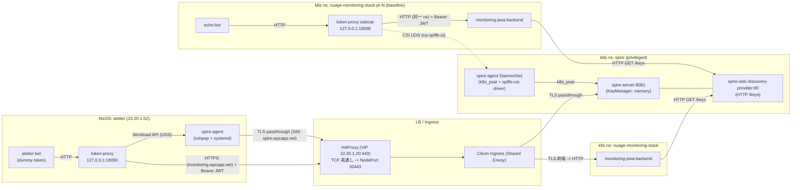

# サーバー間認証標準・SPIRE 導入設計

本ドキュメントは、Nuage エコシステムにおけるサーバー間（サービス間）認証・暗号化の標準方針（第 1 部）と、SPIRE（SPIFFE）を用いた初回導入の具体設計およびリポジトリ間の取り決め（第 2 部）を定義する。

---

## 第 1 部: サーバー間認証の標準

今後 Nuage 上で新規作成・改修するすべてのサービスは、本標準に従ってサーバー間認証を設計・実装する。

### 1. 基本原則

1. **暗号化は基盤が担う**:
   - ネットワーク境界および Ingress では TLS を用いる（現状は Cilium Ingress での TLS 終端・Let's Encrypt）。
   - 将来的な Pod 間・ノード間の通信路暗号化は、基盤側（Cilium の WireGuard / ztunnel 等）で担う。アプリケーションは通信相手の TLS 証明書配布や鍵管理を個別に抱えない。
2. **認証はアプリ層で SPIFFE JWT-SVID を使う**:
   - HTTP / WebSocket ベースのサーバー間通信の認証には、SPIRE が発行する短寿命な **JWT-SVID**（`Authorization: Bearer <JWT-SVID>`）を用いる。
   - サービスの再構築やスケール時にも事前の鍵発行・シークレット配布を不要にし、ステートレスな運用を保つ。
3. **JWT を扱えない経路の方針（X.509-SVID mTLS）**:
   - PostgreSQL・etcd 等の JWT-SVID を扱えないミドルウェア通信、および基盤の通信路暗号化が届かない NixOS ↔ NixOS 間の経路（例: `lm-server` ↔ Victoria 等）には、**X.509-SVID による mTLS** を用いる方針とする。
   - ただし X.509-SVID mTLS の具体実装は本フェーズの対象外であり、今後の導入時に別設計として具体化する。
4. **静的共有トークンの禁止**:
   - サービス間認証のための静的な共有シークレット（API キー、固定の `xoxb-` / `xapp-` トークン、共有パスワード等）を新規に作成しない。既存の静的トークンも順次 JWT-SVID へ移行する。

### 2. SPIFFE ID の名付け規則

Trust Domain は **`nuage`** に統一する。

| 対象種別 | SPIFFE ID 形式 | 例 |
| :--- | :--- | :--- |
| Kubernetes Pod | `spiffe://nuage/ns/<ns>/sa/<sa>` | `spiffe://nuage/ns/nuage-monitoring-stack-pr-42/sa/echo-bot` |
| NixOS サービス | `spiffe://nuage/host/<host>/<service>` | `spiffe://nuage/host/atelier/bot` |

- **専用 ServiceAccount の原則**: Kubernetes Pod に身元を付与する場合、`default` ServiceAccount を流用せず、用途ごとに専用の ServiceAccount を作成して割り当てる。
- **`<host>` と `<service>`**: `<host>` は `nuage-cluster` の `.ssh/ssh_config` および `nix/flake.nix` で用いるホスト名と一致させる。`<service>` はサービス役割を表す小文字ケバブケースとする。

### 3. 受け側の検証ルール

受け側サービスは、受信した JWT-SVID に対して以下をすべて検証する。1 つでも欠ける場合は `401 Unauthorized`（または互換エラー）として即座に拒否し、既定値やフォールバックで通さない。

1. **署名検証（JWKS）**:
   - SPIRE OIDC Discovery Provider が配信する JWKS から公開鍵を取得・キャッシュして署名を検証する。
   - 受信した JWT ヘッダの `kid` がキャッシュに存在しない場合は、最短再取得間隔（クールダウン、例: 5 秒）を設けたうえで JWKS を再フェッチし、SPIRE Server 再起動に伴う鍵更新へ自動追従する。
2. **有効期限検証（`exp` / `nbf`）**:
   - `exp` が過ぎていないこと、`nbf` が未来すぎないことを検証する（クロックスキュー許容は 30 秒以内とする）。
3. **対象者検証（`aud`）**:
   - `aud` クレームに「受け側自身のサービス識別子」（例: `monitoring-pwa`）が含まれることを検証する。他サービス向けのトークン流用を許さない。
4. **呼び出し元認可（`sub` 許可リスト）**:
   - `sub` クレーム（呼び出し元の SPIFFE ID）が、**git で宣言された許可リスト**（必要に応じてロールやアプリ内ユーザー ID との対応表を含む）に完全一致することを検証する。
   - 許可リストが未設定または空の状態で起動した場合はエラーとして起動を止める。

#### Go バックエンドでの実装層（`docs/backend-architecture.md` 準拠）

Go バックエンドで JWT-SVID 検証を実装する場合は、`github.com/spiffe/go-spiffe/v2` または標準的な JWT/OIDC ライブラリ（例: `github.com/golang-jwt/jwt/v5` + JWKS 取得クライアント）を使用し、[docs/backend-architecture.md](backend-architecture.md) の層分けに従って以下に配置する。

| 層 | 配置する責務 |
| :--- | :--- |
| `internal/config/` | JWKS URL、期待する `aud`、許可 `sub` リスト（対応表）の読み込みと必須チェック。欠落時は起動エラーにする。 |
| `internal/domain/` | 認証済みの呼び出し元を表す純粋な Go 型（例: `BotIdentity`、JSON タグなし）。 |
| `internal/usecase/` | 検証ポート（例: `BotTokenVerifier` interface）の宣言と、`sub` に基づく認可・ドメイン識別子の解決。JWT ライブラリや HTTP に依存しない。 |
| `internal/infra/` | JWKS の HTTP 取得・キャッシュと JWT 署名・`exp`・`aud` 検証の具象実装（例: `infra/spiffe/`）。 |
| `internal/adapter/` | リクエストの `Authorization: Bearer <token>` からトークン文字列を取り出し、`usecase` へ渡すだけにする。`infra` を import しない。 |
| `cmd/<app>/main.go` | `config` で読み込んだ設定をもとに `infra` の検証器を生成し、`usecase` へ注入する。 |

### 4. 送り側の約束

1. **アプリは SVID を直接扱わない**:
   - 送り側アプリケーションは SPIFFE Workload API ソケット通信や JWT-SVID の更新処理を自前で実装しない。
   - ローカル（`127.0.0.1:<port>`）で待ち受ける **トークン付与プロキシ** に対して平文 HTTP でリクエストを送り、プロキシが最新の JWT-SVID を `Authorization: Bearer` へ付与（または上書き）して宛先へ転送する。
2. **短寿命・宛先限定**:
   - JWT-SVID の有効期限（TTL）は数分（標準 **`5m`**）とし、プロキシが Workload API 経由で自動更新する。
   - `aud` はプロキシ設定で宛先サービスごとに固定し、異なる宛先へ同じトークンを使い回さない。
3. **既存 SDK との互換**:
   - Slack SDK 等の既存クライアントが非空のトークン文字列を必須とする場合は、ダミー文字列（例: `xoxb-spiffe`、`xapp-spiffe`）を渡す。通信時にプロキシが本物の JWT-SVID で `Authorization` ヘッダを上書きするため、ダミー値が受け側で認可に使われることはない。

### 5. 新しいサービスに身元を付ける手順

SPIRE Server に対する手動の `spire-server entry create` は行わず、すべて git で宣言する。

1. **送り側の身元を宣言する（`nuage-cluster`）**:
   - **Kubernetes Pod の場合**: アプリ側マニフェストで専用 `ServiceAccount` を作成して Pod に割り当て、`nuage-cluster` の `manifests/apps/spire/` に `ClusterSPIFFEID` を宣言する。
   - **NixOS サービスの場合**: 専用 systemd ユニット（または専用ユーザー）を定義し、`nuage-cluster` の `manifests/apps/spire/` に `ClusterStaticEntry`（親 ID にホストの `sshpop` エージェント、セレクタに `systemd:id:<unit>.service`）を宣言する。
2. **送り側にトークン付与プロキシを配置する**:
   - Kubernetes Pod はサイドカーコンテナ、NixOS サービスは systemd ユニットとしてトークン付与プロキシを起動し、宛先 URL と `aud` を設定する。
3. **受け側の許可リストへ登録する（対象アプリのリポジトリ）**:
   - 受け側サービスの許可リスト（ConfigMap / 環境変数定義）に送り側の SPIFFE ID（`sub`）を追記し、PR・Argo CD 経由で反映する。

---

## 第 2 部: 今回の導入設計とリポジトリ間の取り決め

初回適用対象である **「atelier（NixOS）の bot → 本番 `monitoring-pwa`」** および **「preview `echo-bot`（Pod）→ preview `monitoring-pwa`」** を構築するため、`nuage-cluster` と `nuage-monitoring-stack` が並行実装で食い違わない仕様と取り決めを以下に確定する。

### 1. 全体構成



### 2. SPIRE 基盤の設計（`nuage-cluster`）

#### 2.1. 配置と導入方式

- **Namespace**: `spire`
  - `spire-agent` と `spiffe-csi-driver` がホストパス・CSI ソケットの特権を要するため、Namespace ラベルに PSA `privileged`（`pod-security.kubernetes.io/enforce: privileged`）を付与する。
- **導入チャート**: `spiffe/helm-charts-hardened`（`spire-crds` および `spire` チャート）を `nuage-cluster/manifests/apps/spire/` に配置する。
  - 既存の `nuage-cluster/manifests/apps/appset-prod.yaml` は `manifests/apps/*/overlays/prod` を自動検知し、`argocd-vault-plugin-kustomize`（`kustomize build --enable-helm .`）でレンダリングしてディレクトリ名と同じ Namespace（`spire`）へ配備する。この規約に従い、`manifests/apps/spire/base/` と `manifests/apps/spire/overlays/prod/` を作成する。
  - `spire-crds` は `spire` 本体より先に CRD が存在する必要があるため、Argo CD SyncWave（例: `spire-crds` 側を別ディレクトリまたは SyncWave `-1`）または `includeCRDs: true` の適用順序に留意する。

#### 2.2. SPIRE Server・ステートレス設定・JWKS

| 項目 | 決定値 | 備考 |
| :--- | :--- | :--- |
| Trust Domain | `nuage` | 全環境共通 |
| クラスタ名 (`clusterName`) | `nuage` | `k8s_psat` の親 SPIFFE ID に使用 |
| `KeyManager` | `memory` | CA 鍵を永続化せず RAM 上のみで保持（`disk` は無効化） |
| `DataStore` | `sql` (`sqlite3`) | `persistence.enabled: false`（`emptyDir` 上の使い捨て。PVC 不使用） |
| `spire-server` レプリカ / 更新戦略 | `replicaCount: 1`、`updateStrategy.type: Recreate` | メモリ鍵のため単一インスタンス＋再作成で鍵不整合を防ぐ |
| JWT-SVID デフォルト TTL | `5m` | 短寿命トークン原則に準拠 |
| Controller Manager | 有効 (`spire-controller-manager`) | `ClusterSPIFFEID` / `ClusterStaticEntry` を監視・登録 |
| OIDC Discovery Provider Service 名 | `spire-oidc-discovery-provider` | Namespace `spire`、ClusterIP port `80` |
| OIDC Discovery Provider スキーム設定 | `allow_insecure_scheme: true` | クラスタ内通信のため HTTP で提供（外部 Ingress 公開しない） |
| **JWKS URL（確定値）** | `http://spire-oidc-discovery-provider.spire.svc.cluster.local/keys` | `monitoring-pwa` に渡す URL |

- **OIDC Discovery Provider の `domains`**: `spire-oidc-discovery-provider.spire.svc.cluster.local` と `spire-oidc-discovery-provider.spire.svc` を指定する。
- **ステートレス再起動時の挙動**: SPIRE Server 再起動時は CA 鍵と SQLite が初期化され、新しい CA 鍵が生成される。`spire-controller-manager` が CRD から登録エントリを再同期し、OIDC Discovery Provider が新公開鍵を `/keys` に反映する。Agent がキャッシュ済みバンドルとの不一致で再接続に失敗しないよう、Agent 側のブートストラップ設定・再起動追従を「実装で最初に確かめること」で確認する。

#### 2.3. atelier からの接続経路（`spire.wpcapp.net` / TLS passthrough）

- **FQDN**: `spire.wpcapp.net`（接続ポート `443`）
- **DNS・LB**: 変更しない。
  - LB の CoreDNS（`nix/hosts/loadbalancer/dns.nix`）が `*.wpcapp.net` を SDN クライアント（atelier `10.20.1.52` を含む）向けに `10.20.1.20` へ解決する。
  - LB の HAProxy（`nix/hosts/loadbalancer/haproxy.cfg`）は `*:443` を `mode tcp` のまま worker の NodePort `30443` へ素通しする。
- **Cilium Ingress 設定**: `spire` Namespace に以下を配置し、SNI で TLS ストリームを復号せず `spire-server:8081` へ転送する。cert-manager の TLS Secret は作らない（SPIRE Server 自身が SPIFFE 証明書で終端するため）。
  - `ingressClassName: cilium`
  - `annotations`: `ingress.cilium.io/tls-passthrough: "enabled"`
  - `spec.rules[0].host`: `spire.wpcapp.net`
  - `backend.service`: `name: spire-server`, `port.number: 8081`（Helm チャートの実際の Service 名・ポート名に合わせる）
- **うまくいかない場合の代替案**:
  1. **代替案 1**: Cilium Gateway API の `Gateway` + `TLSRoute` を使う（Cilium values への `gatewayAPI` 有効化要否を確認する）。
  2. **代替案 2**: Ingress / Gateway API のいずれも `spire-agent` が接続できない場合は、実装を進めず人間に戻す（代替構成は SPIRE Server を NixOS LXC に置く案であり、LXC 追加と `terragrunt apply` が必要になるため）。

#### 2.4. k8s SPIRE Agent と `spiffe-csi-driver`

- `spire-agent` DaemonSet を有効化し、`nodeAttestor` は `k8s_psat` を使う。
- `spiffe-csi-driver` DaemonSet を有効化し、Pod が `csi.spiffe.io` インラインボリュームで Workload API ソケット（コンテナ内 `/spiffe-workload-api/spire-agent.sock`）をマウントできるようにする。

---

### 3. atelier の SPIRE Agent と SSH CA（`nuage-cluster`）

#### 3.1. NixOS モジュールと設定

- **モジュール**: `nuage-cluster/nix/modules/spire-agent.nix` を新設し、`nuage-cluster/nix/hosts/atelier/configuration.nix` から import する。
- **パッケージ**: nixpkgs の `pkgs.spire-agent`（`pkgs.spire` 系統）を使用する。
- **Server 接続先**: `server_address = "spire.wpcapp.net"`, `server_port = "443"`, `trust_domain = "nuage"`, `insecure_bootstrap = true`。
- **NodeAttestor (`sshpop`)**:
  - `host_key_path = "/var/lib/nix-provisioning/ssh_host_ed25519_key"`（既存の cloud-init 配置鍵。VM 再作成時も `host-keys.yaml` から復元される）。
  - `host_cert_path = "/etc/spire/atelier-cert.pub"`（git 管理下の `.ssh/certs/atelier-cert.pub` を NixOS 設定で配置）。
  - `/var/lib/nix-provisioning/ssh_host_ed25519_key` は `root:root` (`0600`) であるため、`spire-agent.service` は `root` または systemd `LoadCredential` 経由で鍵を読み込む（`systemd` workload attestor のため D-Bus・`/proc` 参照権限も確保する）。
- **WorkloadAttestor**:
  - `WorkloadAttestor "systemd" {}`（主判定）および `WorkloadAttestor "unix" {}` を有効にする。
  - プロキシサービス（`monitoring-bot-proxy.service`）のプロセスが Workload API ソケットへ接続すると、`systemd:id:monitoring-bot-proxy.service` セレクタが付与される。
- **Workload API ソケットパス**: `/run/spire/sockets/agent.sock`（プロキシユニットのみが接続できるようソケット権限・グループ、例: `0660` + 専用グループまたは `spire-agent` グループで保護する）。
- **ステートレス Server 追従**: `data_dir` を揮発性ディレクトリ（例: systemd の `RuntimeDirectory=spire-agent` による `/run/spire-agent`）に置き、Agent 再起動時に古い CA バンドルが残らない構成にする。

#### 3.2. `ClusterStaticEntry`（atelier の bot）

`nuage-cluster/manifests/apps/spire/` に宣言する（`parentID` の `<fingerprint>` は、人間がホスト証明書へ署名した後に実値を確認して埋める）。

```yaml
apiVersion: spire.spiffe.io/v1alpha1
kind: ClusterStaticEntry
metadata:
  name: atelier-monitoring-bot
spec:
  spiffeID: "spiffe://nuage/host/atelier/bot"
  parentID: "spiffe://nuage/spire/agent/sshpop/<atelierホスト証明書のfingerprint>"
  selectors:
    - "systemd:id:monitoring-bot-proxy.service"
  jwtSVIDTTL: "5m"
```

#### 3.3. SSH CA とホスト証明書署名手順（人間の作業）

AI エージェントは SOPS 操作禁止ルールに従い、CA 秘密鍵の生成・SOPS 格納・ホスト証明書署名は人間が実行する。

- **SOPS ファイル配置**: `terraform/pve/hosts-secrets/ssh-ca.yaml`（新規）
  - `.sops.yaml` に `admin_key` と `master_key` のみを復号者とする `creation_rules` を追加する（Argo CD や個別ホストには復号させない）。
- **公開鍵の git 配置**:
  - `.ssh/ssh-ca.pub` と `manifests/apps/spire/base/ssh-ca.pub` に CA 公開鍵を置く（同一内容）。
  - 署名済みホスト証明書は `.ssh/certs/<host>-cert.pub`（今回は `.ssh/certs/atelier-cert.pub`）に保存し、公開情報として git にコミットする。
- **スクリプト対応（`nuage-cluster`）**:
  - `scripts/gen-host-keys.sh` を拡張する（または同ディレクトリに `scripts/sign-host-keys.sh` を追加し、`gen-host-keys.sh` からも呼び出せるようにする）。
  - 既存のホスト鍵を作り直さず、`.ssh/known_hosts`（または SOPS の `host-keys.yaml` から抽出した公開鍵）に対して `ssh-keygen -s` でホスト証明書だけを発行する `--sign-only <ホスト名>...`（例: `-h -I "<host>" -n "<host>" -V "+520w"` 等、長期運用またはローテーション前提）を用意し、`atelier` は既存のホスト鍵を保持したまま署名する。

---

### 4. トークン付与プロキシの設計（`spiffe-token-proxy`）

#### 4.1. 採用方式の判断（OSS 設定のみ vs 小さな Go プログラム）

既存の OSS の設定だけで実現できるかを検討した結果、以下の制約から **小さな Go プログラム（`spiffe-token-proxy`）の自作** を採用する。

- **Caddy**: `{file.<path>}` プレースホルダは設定読み込み・リロード時に 1 回だけ評価されるため、5 分ごとに更新される JWT-SVID ファイルへ動的追従できない（外部から定期 `caddy reload` を叩く仕組みが別途必要になる）。
- **Envoy**: `credential_injector`（`Generic`）の `watched_directory` 動的リロードは `spiffe-helper` が出力する生の JWT テキストファイルではなく Envoy SDS 形式の Secret YAML/Protobuf を要求し、Lua フィルタのファイル読み込みも起動時キャッシュが基本となるため設定ファイルのみでは完結しない。また k8s サイドカーとしてはメモリフットプリントが過大である。
- **Go プログラム採用の利点**:
  - `github.com/spiffe/go-spiffe/v2` の `workloadapi.NewJWTSource` を用いて Workload API ソケットから `aud` 指定の JWT-SVID を直接取得・自動更新できるため、`spiffe-helper` とのファイル受け渡しプロセスを別途常駐させる必要がない。
  - `nuage-workspace` の k8s ポリシー（`probes.rego`）が全コンテナに `readinessProbe` / `livenessProbe` を要求するため、単一コンテナで `/healthz` エンドポイントを併設できる構成が必須となる。
  - `net/http/httputil.NewSingleHostReverseProxy` により WebSocket Upgrade を含む HTTP リバースプロキシを約 150 行規模の単一バイナリで実装でき、NixOS と k8s サイドカーで同一バイナリを共有できる。

#### 4.2. 置き場所の取り決め

新しい GitHub リポジトリは作成せず、基盤リポジトリである **`nuage-cluster`** に配置する。

| 成果物 | 置き場所・命名 |
| :--- | :--- |
| Go ソースコード・`Dockerfile` | `nuage-cluster/tools/spiffe-token-proxy/`（`go.mod`, `main.go`, `*_test.go`, `Dockerfile`） |
| コンテナイメージ | `ghcr.io/k-wa-wa/nuage-cluster-spiffe-token-proxy:latest`（`nuage-cluster/.github/workflows/docker-build-push.yml` から `nuage-workspace` 共通 workflow を呼び出してビルド・Trivy スキャン・push） |
| Nix パッケージ | `nuage-cluster/nix/pkgs/spiffe-token-proxy/default.nix`（`buildGoModule`）、`nix/flake.nix` の `packages.x86_64-linux.spiffe-token-proxy` として公開 |
| NixOS サービスモジュール | `nuage-cluster/nix/modules/spiffe-token-proxy.nix`（`nix/hosts/atelier/` で `monitoring-bot-proxy.service` として有効化） |

#### 4.3. プロキシの振る舞いと設定項目

プロキシは以下の環境変数で動作する。必須項目のいずれかが欠落・不正な場合は既定値で続行せず起動エラーで終了する。

| 設定項目 | 環境変数名 | 必須 | 説明・既定動作 | atelier での設定値 | preview `echo-bot` での設定値 |
| :--- | :--- | :--- | :--- | :--- | :--- |
| 待ち受けアドレス | `PROXY_LISTEN_ADDR` | 必須 | 平文 HTTP 待ち受け先（必ず `127.0.0.1:<port>`） | `127.0.0.1:18090` | `127.0.0.1:18090` |
| ヘルスチェック用アドレス | `HEALTH_LISTEN_ADDR` | 任意 | `/healthz` のみを返す管理用アドレス（プロキシ本体を外部 IP に晒さず kubelet probe を通すため分離） | `127.0.0.1:18091` | `:18091` |
| 宛先 URL | `PROXY_TARGET_URL` | 必須 | 転送先ベース URL（`https://` またはクラスタ内同一 ns 向け `http://`） | `https://monitoring.wpcapp.net` | `http://monitoring-pwa-backend` |
| 宛先 `aud` | `SPIFFE_AUDIENCE` | 必須 | JWT-SVID に要求する `aud` クレーム | `monitoring-pwa` | `monitoring-pwa` |
| Workload API ソケット | `SPIFFE_ENDPOINT_SOCKET` | 必須 | SPIRE Agent の UDS パス（`unix://...` 形式） | `unix:///run/spire/sockets/agent.sock` | `unix:///spiffe-workload-api/spire-agent.sock` |
| JWT ファイルパス | `JWT_FILE_PATH` | 不採用 | `spiffe-helper` 経由ファイル方式は採らず `SPIFFE_ENDPOINT_SOCKET` 直結方式に統一したため設定項目から除外 | — | — |

- **リクエスト処理**:
  1. `127.0.0.1:18090` で受信したリクエストの `Authorization` ヘッダ（bot が付けたダミーの `xoxb-` / `xapp-` 等）を破棄し、`JWTSource.FetchJWTSVID(ctx, jwtsvid.Params{Audience: cfg.Audience})` で得た最新の `Authorization: Bearer <JWT-SVID>` に差し替える。
  2. JWT-SVID 取得に失敗した場合は `503 Service Unavailable` を返し、トークン無しやダミートークンのまま宛先へ転送しない。
  3. **`Host` ヘッダの扱い**: プロキシはリクエストの `Host` ヘッダおよび `r.URL` のスキーム・ホストを `PROXY_TARGET_URL` のホストへ書き換えて転送する（Cilium Ingress が SNI / `Host: monitoring.wpcapp.net` でルーティングするため必須）。
  4. **WebSocket Upgrade**: `httputil.ReverseProxy` により WebSocket Upgrade ヘッダも透過転送可能とする。

#### 4.4. Socket Mode の WebSocket 接続方式（確定仕様）

`nuage-monitoring-stack` の `monitoring-pwa/backend/internal/adapter/slackapi/dispatch.go`（`handleAppsConnectionsOpen`）は、受け取ったリクエストの `Host` と TLS / `X-Forwarded-Proto` から WebSocket URL（`wss://<Host>/slack/socket?ticket=<ticket>` または `ws://<Host>/slack/socket?ticket=<ticket>`）を組み立てて返す。

本設計ではプロキシが `Host` を宛先ホストへ書き換えるため、以下の挙動で統一する。

1. bot の `WebClient`（HTTP API）が `http://127.0.0.1:18090/slack/api/apps.connections.open` を呼ぶ。
2. プロキシが `Authorization: Bearer <JWT-SVID>` を付与し、`Host` を宛先ホストに書き換えて `monitoring-pwa` へ転送する。
3. `monitoring-pwa` が JWT-SVID を検証し、ワンタイム `ticket` を発行して以下を返す。
   - **atelier → 本番**: `wss://monitoring.wpcapp.net/slack/socket?ticket=<ticket>`（Cilium Ingress 経由の HTTPS であり `X-Forwarded-Proto: https` が付くため `wss://` になる）
   - **preview `echo-bot` → preview backend**: `ws://monitoring-pwa-backend/slack/socket?ticket=<ticket>`
4. bot の `SocketModeHandler` は返却された URL へ**プロキシを介さず直接接続**する。WebSocket 接続（`/slack/socket`）は有効期限・1 回限りの `ticket` によって認可されるため安全に成立し、かつ長時間接続の WebSocket をプロキシに滞留させずに済む。

#### 4.5. atelier 開発中の bot との約束

`nuage-autopilot5` 側で開発中の atelier bot には、以下を接続仕様として伝える。

- **Slack API Base URL**: 環境変数で切り替え可能にし、本番接続時は `http://127.0.0.1:18090/slack/api/` を指定する（末尾の `/slack/api/` まで含めること。`monitoring-pwa` のルーターは `/slack/api/:method` で待ち受けているため）。
- **トークン**: `SLACK_BOT_TOKEN`・`SLACK_APP_TOKEN` 等の環境変数はそのまま残し、プロキシ経由時はダミー値（例: `xoxb-spiffe`、`xapp-spiffe`）を渡す。

---

### 5. `monitoring-pwa` の改修仕様（`nuage-monitoring-stack`）

#### 5.1. 新しい環境変数と形式

`monitoring-pwa/backend/internal/config/config.go` から `SLACK_BOT_TOKEN` と `SLACK_APP_TOKEN` の読み込み・`xoxb-` / `xapp-` 必須検証を削除し、以下の環境変数へ置き換える。

| 環境変数名 | 必須 | 形式・内容 | 検証ルール |
| :--- | :--- | :--- | :--- |
| `SPIFFE_JWKS_URL` | 必須 | `http://spire-oidc-discovery-provider.spire.svc.cluster.local/keys` | 空不可。有効な `http://` または `https://` URL であること |
| `SPIFFE_JWT_AUDIENCE` | 必須 | `monitoring-pwa` | 空不可 |
| `BOT_USERS_JSON` | 必須 | 許可する bot 一覧の JSON 配列（下例参照） | 1 件以上必須。`sub`（`spiffe://` 始まり・重複不可）、`user_id`（`U` 始まり・重複不可）、`bot_id`（`B` 始まり・重複不可）、`name`（空不可） |

`BOT_USERS_JSON` の JSON スキーマ例:

```json
[
  {
    "sub": "spiffe://nuage/host/atelier/bot",
    "user_id": "U01BOT",
    "bot_id": "B01BOT",
    "name": "nuage-bot"
  }
]
```

#### 5.2. 本番と preview の宣言方法

- **本番（`nuage-monitoring-stack/k8s/overlays/prod/`）**:
  - `k8s/overlays/prod/secrets/secrets.yaml` から平文の `SLACK_BOT_TOKEN` と `SLACK_APP_TOKEN` の 2 行を削除する（同ファイル内の `COOKIE_SIGNING_KEY`・`USERS_JSON`・`VAPID_*` は変更しない）。
  - 本番用設定（ConfigMap または `k8s/overlays/prod/` の Deployment パッチ。秘密情報ではないため SOPS 暗号化不要）で以下を宣言する。
    - `SPIFFE_JWKS_URL`: `http://spire-oidc-discovery-provider.spire.svc.cluster.local/keys`
    - `SPIFFE_JWT_AUDIENCE`: `monitoring-pwa`
    - `BOT_USERS_JSON`: `[{"sub":"spiffe://nuage/host/atelier/bot","user_id":"U01BOT","bot_id":"B01BOT","name":"nuage-bot"}]`
- **preview（`nuage-monitoring-stack/k8s/overlays/preview/`）**:
  - `k8s/overlays/preview/local-secrets.yaml` から `SLACK_BOT_TOKEN` と `SLACK_APP_TOKEN` の 2 行を削除する。
  - PR ごとに変わる preview Namespace 名に自動追従させるため、`k8s/overlays/preview/kustomization.yaml` の `monitoring-pwa-backend` パッチで **Kubernetes Downward API（`POD_NAMESPACE`）と環境変数展開 `$(POD_NAMESPACE)`** を使って宣言する（Argo CD の `ApplicationSet` テンプレートを変更する必要がない）。
    ```yaml
    - name: POD_NAMESPACE
      valueFrom:
        fieldRef:
          fieldPath: metadata.namespace
    - name: SPIFFE_JWKS_URL
      value: "http://spire-oidc-discovery-provider.spire.svc.cluster.local/keys"
    - name: SPIFFE_JWT_AUDIENCE
      value: "monitoring-pwa"
    - name: BOT_USERS_JSON
      value: '[{"sub":"spiffe://nuage/ns/$(POD_NAMESPACE)/sa/echo-bot","user_id":"U01BOT","bot_id":"B01BOT","name":"echo-bot"}]'
    ```
  - preview 環境ではこの規則により `spiffe://nuage/ns/nuage-monitoring-stack-pr-<N>/sa/echo-bot` のみが受け付けられ、他の PR（`pechka-pr-*` 等）からのなりすましを受け付けない。

#### 5.3. API・WebSocket 認可の変更点

- `POST /slack/api/:method`（`apps.connections.open` および bot メソッドすべて）:
  - `Authorization: Bearer <token>`（form の `token` パラメータでの送信は新規方式では使わない。JWT-SVID は常に `Authorization: Bearer` で受け取る）を取り出し、JWT-SVID を検証して一致する `BotIdentity` を解決する。
  - `auth.test`・`chat.postMessage`・`users.info` は解決された `BotIdentity`（`user_id`、`bot_id`、`name`）を使って応答・メッセージ保存を行う（既存の `@bot` / `@nuage-bot` メンション正規化との互換のため、標準の bot `user_id` は `U01BOT` とする）。
- `GET /slack/socket`:
  - `SocketUsecase.AuthorizeSocket` から静的 `appToken` による認可フォールバックを削除し、**`apps.connections.open` が発行したワンタイム `ticket` のみ** で認可する。

---

### 6. `echo-bot`（preview）と境界制約（NetworkPolicy / AppProject）

#### 6.1. `echo-bot` マニフェスト（`nuage-monitoring-stack/k8s/overlays/preview/`）

- **ServiceAccount**: `nuage-monitoring-stack/k8s/overlays/preview/` に `kind: ServiceAccount`, `metadata.name: echo-bot` を追加し、`echo-bot.yaml` の Pod に `serviceAccountName: echo-bot` を指定する。
  - `nuage-cluster/manifests/apps/preview-project.yaml` の `namespaceResourceWhitelist` には既に `ServiceAccount` が含まれているため、`preview-apps` AppProject でそのまま同期可能である。
- **echo-bot コンテナ環境変数**:
  - `SLACK_API_BASE_URL`: `"http://127.0.0.1:18090/slack/api/"`
  - `SLACK_BOT_TOKEN`: `"xoxb-spiffe"`（ダミー値）
  - `SLACK_APP_TOKEN`: `"xapp-spiffe"`（ダミー値）
  - （`pwa-notifier-secret` からの `SLACK_*_TOKEN` 参照を外す）
- **`token-proxy` サイドカー追加**:
  - イメージ: `ghcr.io/k-wa-wa/nuage-cluster-spiffe-token-proxy:latest`、`imagePullPolicy: Always`
  - Deployment アノテーションの `keel.sh/monitorContainers` を `"^(echo-bot|token-proxy)$"` に更新する（`nuage-workspace` の `keel.rego` ポリシー準拠）。
  - `readinessProbe` / `livenessProbe` はポート `18091` の `/healthz` を指定する（`probes.rego` 準拠）。
  - `resources.requests` / `resources.limits` を設定し、`securityContext`（`runAsNonRoot`, `readOnlyRootFilesystem: true`, `allowPrivilegeEscalation: false`, `capabilities.drop: ["ALL"]`）を付与する。
  - CSI ボリュームをマウントする:
    ```yaml
    volumes:
      - name: spiffe-workload-api
        csi:
          driver: csi.spiffe.io
          readOnly: true
    ```
    コンテナ側マウント先: `/spiffe-workload-api`（`SPIFFE_ENDPOINT_SOCKET=unix:///spiffe-workload-api/spire-agent.sock`）。

#### 6.2. `ClusterSPIFFEID` の宣言場所（`preview-apps` AppProject 制約）

- `preview-apps` AppProject（`nuage-cluster/manifests/apps/preview-project.yaml`）は `clusterResourceWhitelist` で **`Namespace` 以外のクラスタスコープリソースを全面禁止** しており、`nuage-workspace` の `preview.rego` でも preview overlay へのクラスタ影響リソース混入を禁止している。
- したがって、**`ClusterSPIFFEID` はすべて `nuage-cluster/manifests/apps/spire/` に一元宣言する**。`nuage-monitoring-stack` 側には一切置かない。
- `echo-bot` 用 `ClusterSPIFFEID`:
  ```yaml
  apiVersion: spire.spiffe.io/v1alpha1
  kind: ClusterSPIFFEID
  metadata:
    name: preview-echo-bot
  spec:
    spiffeIDTemplate: "spiffe://nuage/ns/{{ .PodMeta.Namespace }}/sa/{{ .PodSpec.ServiceAccountName }}"
    namespaceSelector:
      matchLabels:
        pod-security.kubernetes.io/enforce: baseline
    podSelector:
      matchLabels:
        app: monitoring-pwa-echo-bot
    workloadSelectorTemplates:
      - "k8s:ns:{{ .PodMeta.Namespace }}"
      - "k8s:sa:{{ .PodSpec.ServiceAccountName }}"
    jwtSVIDTTL: "5m"
  ```
  - 1 つの宣言で全 PR preview Namespace（`baseline` ラベル付き）の `echo-bot` にマッチする。他リポジトリ（`pechka-pr-*` 等）が同名ラベル・SA を使っても SPIFFE ID の `<ns>` が異なるため、対象 PR の `monitoring-pwa-backend` 側の `BOT_USERS_JSON` で確実に弾かれる。

#### 6.3. preview NetworkPolicy（`nuage-cluster/manifests/apps/preview-network-policy.yaml`）

`preview-isolation-guardrail`（`CiliumClusterwideNetworkPolicy`）による通信可否と必要な追加は以下のとおりである。

| 通信経路 | 現状の可否 | 対応方針 |
| :--- | :--- | :--- |
| `echo-bot` ↔ `token-proxy` | 可（Pod 内 loopback） | 対応不要 |
| `token-proxy` → SPIRE Agent | 可（CSI Unix ドメインソケット通信であり IP ネットワークを通らない） | NetworkPolicy 追加不要（※ PSA `baseline` での `csi` ボリューム許可は実装時に実機確認） |
| `token-proxy` → `monitoring-pwa-backend` | 可（同一 `baseline` Namespace 内の Pod 間通信はルール 1 で許可済み） | 宛先は `http://monitoring-pwa-backend` とする（外部 Ingress URL は RFC1918 VIP に当たり遮断されるため使わない） |
| `monitoring-pwa-backend` → `spire-oidc-discovery-provider`（`spire` ns） | **不可**（現状は `spire` ns への Egress ルールが無い） | **`preview-network-policy.yaml` の `egress` に、`io.kubernetes.pod.namespace: spire` かつ `spiffe-oidc-discovery-provider` Pod ラベル宛ての targetPort（HTTP）許可をピンポイント追加する** |

---

### 7. 作業分担・実施順序・人間の手順

#### 7.1. リポジトリごとの作業分担と実施順序

並行作業も可能だが、実機結合テストは **Step 1（nuage-cluster 基盤）→ 人間手順（SSH CA・署名）→ Step 2（nuage-cluster atelier 有効化 & nuage-monitoring-stack 改修）** の順で収束させる。

1. **Step 1-A（`nuage-cluster`）**: `tools/spiffe-token-proxy/` の実装・単体テスト・Dockerfile・`.github/workflows/docker-build-push.yml`・`nix/pkgs/spiffe-token-proxy` の作成とイメージの GHCR 公開。
2. **Step 1-B（`nuage-cluster`）**: `manifests/apps/spire/`（SPIRE Server / Agent / CSI Driver / OIDC Discovery Provider / Cilium TLS passthrough Ingress / `ClusterSPIFFEID`）・`manifests/apps/preview-network-policy.yaml` 更新・`scripts/gen-host-keys.sh`（または `sign-host-keys.sh`）署名機能追加・`nix/modules/spire-agent.nix` 作成。
3. **人間作業（Step 1 と Step 2 の間）**: SSH CA 鍵生成・SOPS 格納・`atelier` ホスト鍵への署名・CA 公開鍵と署名済み証明書のコミット・push（詳細は 7.2 節）。
4. **Step 1-C（`nuage-cluster`）**: `atelier` のホスト証明書から `fingerprint` を確定して `ClusterStaticEntry` を追加し、`nix/hosts/atelier/configuration.nix` で `spire-agent` と `monitoring-bot-proxy` を有効化、push 後に人間が `nixos-upgrade` を実行。
5. **Step 2（`nuage-monitoring-stack`）**: `monitoring-pwa/backend` の JWT-SVID 検証実装（`config` / `domain` / `usecase` / `infra/spiffe` / `adapter/slackapi`）・契約テスト/単体テスト更新・`k8s/overlays/preview/`（`echo-bot` 用 SA・`token-proxy` サイドカー・`BOT_USERS_JSON`）と `k8s/overlays/prod/`（静的トークン廃止・`BOT_USERS_JSON` 設定）の更新。
   - ※ 安全な移行順序として、PR preview 環境で `echo-bot` ↔ `monitoring-pwa` の JWT-SVID 認証を先に結合確認してから、`nuage-monitoring-stack` の PR をマージして本番 `secrets.yaml` から静的トークンを落とす。

#### 7.2. 人間が行う手順（SOPS・署名・反映）

AI は SOPS 操作および本番反映を行わない。以下は人間が実行する手順である。

1. **SSH CA 秘密鍵の生成と SOPS 格納（初回のみ）**:
   - `nuage-cluster/.sops.yaml` の `creation_rules` に `terraform/pve/hosts-secrets/ssh-ca\.yaml$`（受信者は `*admin_key` と `*master_key` のみ）を追加する。
   - 一時ディレクトリで CA 鍵ペアを生成し、秘密鍵を `sops encrypt` で `terraform/pve/hosts-secrets/ssh-ca.yaml` に保存、公開鍵を `.ssh/ssh-ca.pub` および `manifests/apps/spire/base/ssh-ca.pub` に配置して一時ファイルを破棄する。
   ```bash
   cd ~/ghq/github.com/k-wa-wa/nuage-cluster
   TMP=$(mktemp -d) && chmod 700 "$TMP"
   ssh-keygen -q -t ed25519 -N "" -C "nuage-spire-ssh-ca" -f "$TMP/ssh-ca"
   jq -Rs '{private_key: .}' "$TMP/ssh-ca" \
     | sops encrypt --filename-override terraform/pve/hosts-secrets/ssh-ca.yaml --input-type json --output-type yaml /dev/stdin \
     > terraform/pve/hosts-secrets/ssh-ca.yaml
   cp "$TMP/ssh-ca.pub" .ssh/ssh-ca.pub
   cp "$TMP/ssh-ca.pub" manifests/apps/spire/base/ssh-ca.pub
   rm -rf "$TMP"
   ```
2. **既存 `atelier` ホスト鍵への署名**:
   ```bash
   cd ~/ghq/github.com/k-wa-wa/nuage-cluster
   bash scripts/gen-host-keys.sh --sign-only atelier
   # 生成された .ssh/certs/atelier-cert.pub と証明書 fingerprint を確認し、
   # ClusterStaticEntry の parentID に反映してコミット・push する
   ```
3. **k8s 側（SPIRE / monitoring-pwa）の反映**:
   - `nuage-cluster` および `nuage-monitoring-stack` の PR を確認・マージすると、Argo CD が自動で同期する。
4. **NixOS（`atelier`）への反映**:
   - `nuage-cluster` の `master` へマージ後、`atelier` で `nixos-upgrade` を起動してユニット稼働を確認する（別リポジトリの flake input 更新がある場合は `nix flake update <input> --flake ./nix` を先に行う）。
   ```bash
   ssh atelier 'sudo systemctl start nixos-upgrade; journalctl -u nixos-upgrade -n 20 --no-pager -o cat'
   ssh atelier 'sudo systemctl status spire-agent monitoring-bot-proxy --no-pager'
   ```

---

### 8. 実装で最初に確かめること（先行検証チェックリスト）

実装着手時、後続作業に手戻りを出さないために最初に以下を実機・検証環境で確認する。

1. **Cilium Ingress TLS passthrough と SNI による `spire-agent` 接続**:
   - **確認方法**: `spire` チャートをデプロイし、`ingress.cilium.io/tls-passthrough: "enabled"` 付きの `spire.wpcapp.net` Ingress を作成した状態で、atelier（またはテストクライアント）から `spire-agent` が TLS passthrough 経由で `spire-server:8081` にアテスト・接続できるか確認する。
   - **失敗時の切り分け・代替案**: だめなら Cilium Gateway API の `TLSRoute` を試す。それも不可なら人間に戻す（SPIRE Server の NixOS LXC 配置へ切り替え）。
2. **ステートレス Server 再起動時の CA 追従**:
   - **確認方法**: 接続済みの状態で `spire-server` Pod を削除・再起動して CA 鍵と SQLite を作り直し、① k8s `spire-agent`、② atelier `spire-agent`、③ `spiffe-oidc-discovery-provider` の JWKS（`/keys`）が自動追従し、古い `kid` ではない新 JWT-SVID を `monitoring-pwa` が検証できるか確認する。
   - **失敗時の対処**: Agent が古い CA キャッシュを保持して再接続に失敗する場合は、Agent 側の `data_dir` を揮発領域にし再接続エラー時の自動再起動（または `ExecStartPre` でのバンドル初期化）で必ず再ブートストラップするようにする。
3. **PSA `baseline` 環境における `csi.spiffe.io` インラインボリューム**:
   - **確認方法**: `nuage-monitoring-stack` の PR preview 環境（`pod-security.kubernetes.io/enforce: baseline`）で `csi.spiffe.io` ボリュームを持つ `echo-bot` Pod が Admission 拒否されず起動し、ソケット通信できるか確認する。
4. **Socket Mode の実動作確認**:
   - **確認方法**: `echo-bot` が `token-proxy`（`http://127.0.0.1:18090/slack/api/`）経由で `apps.connections.open` を呼び出し、返却された WebSocket URL へ直接接続してメンション応答が返ること、`invalid_auth` 時にリクエストが通らないことを確認する。

---

### 9. 今回のスコープ外（やらないこと）

以下は本設計の初回導入スコープには含めない。

- Pod 間・Ingress → Pod 間のネットワーク暗号化（Cilium WireGuard / ztunnel 等）
- PostgreSQL、etcd、`lm-server` 等に対する X.509-SVID mTLS の実装
- 人間のユーザーログイン認証（合言葉・bcrypt・署名付き Cookie セッション）の変更
- `nuage-monitoring-stack/k8s/overlays/prod/secrets/secrets.yaml` に含まれるその他平文項目（`COOKIE_SIGNING_KEY`、`USERS_JSON`）の SOPS 化
